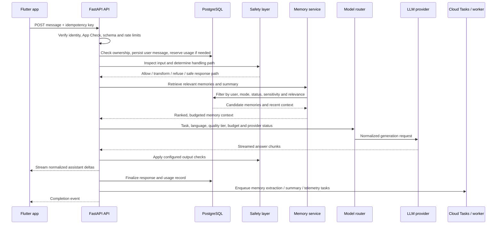
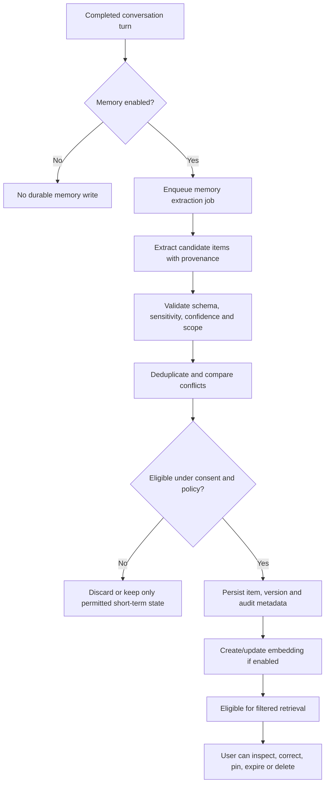
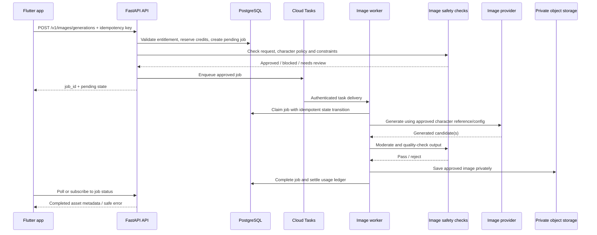

# Juhi — Complete Technical Architecture

**Document status:** Proposed architecture baseline  
**Version:** 1.0  
**Prepared:** 17 October 2026  
**Product:** Juhi — an AI companion for adults, configurable as a girlfriend, boyfriend, romantic partner, close friend, or other consensual companion persona  
**Initial platform:** Android using Flutter  
**Future platforms:** iOS and web  
**Primary launch languages:** English, Hindi, Tamil, Hinglish, and Tanglish  
**Related documents:** `Juhi_AI_Companion_PRD.md`, `Juhi_Design_System.md`

> **Architecture principle:** Build a modular, provider-independent product with reliable memory, a coherent companion identity, safe multimodal interactions, user control, and measurable cost. Do not begin with unnecessary microservices or make the core application dependent on one AI vendor.

---

## 1. Executive summary

Juhi is a mobile-first AI companion whose core experience combines text conversation, persistent memory, persona and relationship preferences, multilingual conversation, generated media, voice messages, and eventually real-time voice calls. The architecture must be capable of evolving from an affordable MVP to a robust service serving many concurrent users without requiring a full rewrite.

### 1.1 Recommended baseline

| Layer | Recommended baseline | Why |
|---|---|---|
| Mobile app | Flutter / Dart | Android-first delivery while preserving a route to iOS |
| Mobile structure | Feature-first MVVM, repositories, services, use cases where useful | Testable UI and separated business logic; aligns with Flutter architecture guidance |
| Authentication | Firebase Authentication | Managed identity and supported sign-in methods |
| App abuse protection | Firebase App Check with Play Integrity on Android, plus backend validation | Adds an app-attestation signal; it does not replace user authentication or authorization |
| API/backend | Python + FastAPI, deployed to Google Cloud Run | Python ecosystem for AI orchestration, simple managed deployment, streaming-capable endpoints |
| Backend structure | Modular monolith for synchronous product APIs; separate worker service for asynchronous tasks | Strong module boundaries without premature distributed-system complexity |
| Primary database | Cloud SQL for PostgreSQL | Transactional data, relational constraints, reporting queries, and `pgvector` for early-stage semantic retrieval |
| Media storage | Google Cloud Storage, private by default | Images and audio should not live as database blobs or be exposed through public buckets |
| Async work | Cloud Tasks targeting an authenticated Cloud Run worker | Retries and scheduling for image generation, memory extraction, summaries, and other long-running work |
| AI integration | Internal provider adapters and a model router | Model providers can change without altering product flows |
| Push | Firebase Cloud Messaging | Delivery mechanism for opted-in notifications and job completion |
| Secrets | Google Cloud Secret Manager + workload identity / least-privilege IAM | Keeps provider credentials out of source code and the mobile app |
| Observability | Cloud Logging, Monitoring, Error Reporting, traces, and product analytics | Understand reliability, experience quality, policy decisions, and unit economics |
| Infrastructure | Separate dev, staging, and production environments; infrastructure as code | Repeatable deployment and blast-radius reduction |

The Google Cloud choices are a recommended starting point, not a claim that Google Cloud is the only viable provider. Select final regions after checking service availability, latency, contractual requirements, data residency, and the processing regions of every external AI provider.

### 1.2 Architecture decisions to preserve

1. **No direct mobile-to-model calls.** All paid-model requests go through Juhi's backend. Provider API keys and policy logic never ship in the app.
2. **Provider independence.** Chat, embeddings, speech recognition, speech generation, image generation, and moderation each use interfaces that can support more than one provider.
3. **One authoritative data layer.** PostgreSQL is the source of truth for users, conversations, messages, memory metadata, entitlements, usage, and generation jobs. Object storage holds media bytes.
4. **Memory is a product subsystem, not a long prompt.** Memory must be consent-aware, typed, provenance-aware, editable, deletable, and evaluated.
5. **Async by default for expensive media.** Images and longer audio processing run as jobs with explicit status and idempotent billing.
6. **Safety is layered.** Prompts help guide behavior, but code-level permissions, moderation, age controls, entitlement checks, output validation, and reporting remain outside the LLM.
7. **Modular monolith first.** Split services only when clear load, reliability, team ownership, or isolation needs justify it.
8. **Privacy-preserving observability.** Record operational metadata by default, not complete private conversations or audio in application logs.
9. **User agency is a non-functional requirement.** Users can inspect and manage memory, set boundaries, control notifications, export data, and delete their account.
10. **Quality before engagement optimization.** Never use fake distress, coercive jealousy, guilt, simulated emergencies, or emotionally timed paywalls to drive retention or spending.

---

## 2. Goals, non-goals, assumptions, and constraints

### 2.1 Goals

- Deliver a reliable Android app for one-to-one text conversation with a selected companion.
- Make English, Hindi, Tamil, Hinglish, and Tanglish first-class interaction modes, with user-controlled language preferences and natural code-switching.
- Provide persistent and correct memory, including user-visible memory controls and separation between real-life memory and fictional story state.
- Maintain consistent persona behavior across text, voice, image prompts, and roleplay.
- Support asynchronous image generation and a voice-message workflow.
- Support subscriptions and/or credits with server-authoritative entitlements and reliable billing reconciliation.
- Keep the AI stack replaceable and instrumented for latency, quality, safety, and cost.
- Establish secure deployment, backups, deletion workflows, test automation, and incident procedures before public launch.

### 2.2 Non-goals for the first MVP

- Real-time audio calls with interruption-aware speech and conversational turn-taking.
- Training a proprietary foundation model.
- Operating a custom GPU fleet for LLM or image inference.
- A public character marketplace or user-to-user social network.
- An elaborate multi-agent system for every ordinary conversation.
- Kubernetes or a microservice per feature at launch.
- Storing every raw audio recording indefinitely.
- Building a separate vector database before PostgreSQL retrieval shows a measurable bottleneck.
- Promising perfect recall, human-equivalent feelings, or a guaranteed therapeutic outcome.

### 2.3 Explicit assumptions

- Juhi is positioned for adults aged 18 and over. Age assurance and enforcement must be designed and reviewed before public launch; a simple self-declaration may not be sufficient for every jurisdiction or distribution channel.
- Initial development favors managed services to reduce operational overhead.
- AI models and vendors may be changed based on price, language quality, safety behavior, latency, terms, and availability.
- The initial product may use a provider such as Venice.ai for suitable tasks only after a technical, privacy, safety, and cost evaluation. No core service should assume that any one provider offers every required capability.
- User-generated data is private by default. Any secondary use for model training or product improvement requires a clear, separate legal basis and transparent disclosure; do not assume vendor settings or terms provide the required user consent.
- The India-first audience does not automatically mean every infrastructure resource or AI provider must be located in India. Data-location decisions require a reviewed data-flow map and legal/product requirements.

---

## 3. Architecture style and system boundaries

### 3.1 Choose a modular monolith for the first release

Deploy one main FastAPI service for synchronous APIs and conversation orchestration, plus one worker service for asynchronous tasks. Organize both around explicit domain modules. A module should expose a clear interface and own its business rules; other modules should not reach directly into its internal functions or tables without a documented boundary.

This is preferable to a microservice-per-feature design at MVP because Juhi's early workload and product behavior are still being validated. Managed runtime scaling and async queues provide a path to capacity without requiring distributed service discovery, multiple deploy pipelines, and cross-service transactions from day one.

**Good initial modules:** identity and access, conversations, companion profiles/personas, memory, AI orchestration, safety, voice, image generation, media assets, entitlements/billing, notifications, analytics events, and support/admin operations.

**Potential future service extractions:** real-time voice gateway, high-volume image pipeline, memory retrieval service, billing integration, or moderation service. Extract only after measurements show a concrete reason.

### 3.2 Logical architecture

```mermaid
flowchart TB
    U[Adult user] --> APP[Flutter Android app]
    APP --> AUTH[Firebase Authentication]
    APP --> CHECK[App Check / Play Integrity]
    APP --> API[FastAPI API on Cloud Run]

    API --> AUTHZ[Auth, ownership, age, entitlement and rate-limit checks]
    AUTHZ --> SAFETY[Input safety and request policy]
    SAFETY --> ORCH[Conversation orchestrator]

    ORCH --> PERSONA[Persona / relationship configuration]
    ORCH --> MEMORY[Memory retrieval and context compiler]
    ORCH --> ROUTER[LLM router and provider adapters]
    ORCH --> MSG[(Cloud SQL PostgreSQL)]
    MEMORY --> PGV[(PostgreSQL + pgvector / full-text search)]

    API --> TASKS[Cloud Tasks]
    TASKS --> WORKER[Authenticated Cloud Run worker]
    WORKER --> MEMJOB[Memory extraction / summarization]
    WORKER --> IMG[Image generation pipeline]
    WORKER --> VOICE[Async voice pipeline]

    IMG --> OBJ[(Private Cloud Storage)]
    VOICE --> OBJ
    ROUTER --> LLM[Approved LLM provider(s)]
    IMG --> IMGPROV[Approved image provider(s)]
    VOICE --> SPEECH[Approved STT / TTS provider(s)]
    SAFETY --> MOD[Moderation / policy services]

    API --> FCM[Firebase Cloud Messaging]
    API --> OBS[Logs, metrics, traces and cost telemetry]
    WORKER --> OBS
    API --> BILL[Store billing verification / entitlement ledger]
    BILL --> MSG
```

### 3.3 System context

Juhi interacts with these external systems:

- **Identity provider:** Firebase Authentication. The backend verifies signed identity tokens and maps external identities to internal user IDs.
- **Model providers:** At least one text model provider; optionally separate providers for embeddings, speech-to-text, text-to-speech, image generation, and moderation.
- **App stores / billing:** Google Play Billing for applicable digital purchases in the Play-distributed Android app, subject to current policy and program-specific exceptions. Use server-side purchase validation and event reconciliation.
- **Notification provider:** Firebase Cloud Messaging. Push notification text should be privacy-conscious and must obey user settings.
- **Cloud platform:** Google Cloud managed compute, database, object storage, task queue, secrets, metrics, and logs.
- **Optional media catalogue provider:** A licensed GIF/sticker search API or a curated internal set. Review license, commercial usage, moderation, and source attribution before launch.

### 3.4 Trust boundaries

1. **Mobile app boundary:** Treat all app inputs and client-supplied state as untrusted. The app is not allowed to declare its own user ID, subscription entitlement, credit balance, moderation result, or memory ownership.
2. **API boundary:** Verify user authentication, app attestation where required, payload size, schema, ownership, rate limits, feature entitlement, and policy constraints before accessing expensive services.
3. **AI provider boundary:** Minimize content sent, use contractual/technical settings appropriate for private content, apply timeouts, and record only the metadata needed for operations and cost control.
4. **Worker boundary:** Accept only authenticated tasks, validate payloads, check ownership/state again, and make jobs idempotent. A queue message is not permission to access arbitrary user data.
5. **Admin boundary:** Internal support actions require role-based access control, least privilege, audit trails, and a documented reason for access to private user data.

---

## 4. Deployment architecture

### 4.1 Production containers and services

| Runtime/service | Responsibilities | Statefulness | MVP priority |
|---|---|---|---|
| Flutter app | UI, local presentation state, audio capture/playback, local cache, API calls | Local device state only | P0 |
| Firebase Authentication | Sign-in and identity lifecycle | Managed | P0 |
| FastAPI API on Cloud Run | REST APIs, authentication verification, synchronous chat stream, access rules, orchestration, billing and usage transactions | Stateless application instances | P0 |
| Cloud SQL PostgreSQL | Primary transactional database, memory metadata, conversation history, usage ledger, selected vector index | Stateful managed database | P0 |
| Private Cloud Storage bucket(s) | Image/audio object bytes and temporary uploads | Stateful managed storage | P0 for generated media; voice storage based on launch scope |
| Cloud Tasks queue(s) | Async image jobs, memory extraction, summarization, notifications, reconciliation | Managed queue | P0 for expensive async work |
| Worker on Cloud Run | Idempotent async tasks, model/provider jobs, post-turn processing | Stateless workers; persistent job state in DB | P0 |
| Firebase Cloud Messaging | Opt-in push delivery | Managed | P1 |
| Secret Manager | API credentials and runtime secrets | Managed | P0 |
| Cloud Monitoring/Logging/Error Reporting | Reliability, alerts, diagnostics | Managed | P0 |
| BigQuery or equivalent analytics warehouse | Aggregated product metrics; minimized event data | Analytical store | P1 after event needs are clear |
| Redis / Memorystore | Hot distributed rate limits, short-lived coordination, carefully scoped cache | Optional | P2; add only when required |
| Cloud Armor / API gateway / load balancer | Edge controls, WAF, centralized routing, advanced quotas | Managed | P2 when exposure and traffic justify it |

### 4.2 Environment strategy

Create separate Google Cloud projects, or an equivalent strict resource boundary, for:

- **Development:** synthetic or developer-owned test data only. No production user exports.
- **Staging:** release candidate validation, integration testing, provider sandbox accounts, test purchases, and synthetic load tests.
- **Production:** tightly controlled IAM, production billing, monitored quotas, backups, and reviewed changes.

Never share production provider keys or unrestricted production database credentials with local developer environments. Enforce environment-specific configuration and secret names.

### 4.3 Region selection

Choose a primary region after checking Cloud Run, Cloud SQL, Cloud Storage, Cloud Tasks, data processing, disaster recovery, and provider support. Keep latency-sensitive services close to the database. Document each third-party AI provider's actual data-processing region and retention terms; a region choice for Juhi's database does not guarantee that external processing occurs in the same region.

### 4.4 Network and access baseline

- Use HTTPS/TLS for public APIs and service-to-service calls.
- Give each workload its own service identity and minimum necessary IAM roles.
- Keep database ingress private where operationally practical; do not expose PostgreSQL directly to the public internet.
- Use workload identity / managed service identities instead of downloaded service-account key files.
- Require authenticated invocations for worker endpoints.
- Avoid broad admin permissions for developers and automated CI jobs.
- Define separate service accounts for API, worker, deployment pipeline, and data maintenance tasks.

---

## 5. Mobile application architecture

### 5.1 Pattern

Use a **feature-first Flutter architecture** with Views, ViewModels, Repositories, and Services. Add a small domain/use-case layer for workflows that combine multiple repositories or encode important product rules. This broadly follows the official Flutter architecture guidance: [Flutter app architecture](https://docs.flutter.dev/app-architecture/guide).

Avoid putting network requests, model policy, billing rules, or complicated conditional logic directly in widgets.

### 5.2 Proposed mobile packages

Choose stable package versions at implementation time and pin them through the normal Flutter dependency process. The list below is a proposal, not a requirement to adopt every package.

| Capability | Candidate | Notes |
|---|---|---|
| State management / dependency injection | Riverpod or an equivalent single, consistent approach | Pick one convention and document it; do not mix multiple state-management patterns without reason |
| Routing | `go_router` or equivalent | Centralize authenticated and onboarding route guards |
| HTTP | `dio` or a small typed HTTP client | Add request IDs, auth tokens, App Check tokens, timeouts, and structured API errors |
| Models | `freezed` + `json_serializable` or equivalent | Typed domain and API models; generate rather than hand-maintain repetitive serializers |
| Auth | Firebase Authentication SDK | Never trust a UID passed in request JSON |
| App attestation | Firebase App Check / Play Integrity | Include and validate tokens when backend protection is enabled |
| Secure token storage | `flutter_secure_storage` or platform secure storage | Store only secrets/tokens that require it; do not use it as a general database |
| Local cache | SQLite-based store such as Drift, with an explicit data-retention design | Cache only what is required; avoid caching full history by default if it is not needed |
| Audio recording/playback | A maintained Flutter audio package chosen after device tests | Verify Android permissions, lifecycle, interruption, Bluetooth routing, and codec behavior |
| Push | Firebase Cloud Messaging | Only send notifications consistent with user preferences and privacy settings |
| In-app billing | Google Play Billing integration via a maintained Flutter plugin | Purchase verification must occur on the backend |
| Crash reporting | Firebase Crashlytics or approved equivalent | Scrub request content, tokens, and personal data from crash breadcrumbs |

### 5.3 Feature modules

- `auth`: sign-in, sign-out, token refresh, session state, account deletion entry point.
- `onboarding`: age assurance flow, consent, language, display name, relationship type, boundaries, initial persona.
- `chat`: message list, composer, streaming, retry, message status, feedback, attachment entry points.
- `companion`: persona card, appearance settings, voice selection, relationship settings, personality controls.
- `memory`: inspect, correct, pin, expire, delete, and pause memory.
- `media`: image jobs, media viewer, saved images, audio messages, GIFs/stickers when enabled.
- `voice`: recording, transcription preview if appropriate, playback, voice response settings.
- `stories`: fictional story/session state separated from real-life memory.
- `billing`: plans, credit balance, purchase UI, restore/sync, transaction status.
- `notifications`: notification permissions, category preferences, quiet hours, pause companion notifications.
- `privacy`: export, deletion, consent, data settings, privacy explanations.
- `settings`: language, theme, accessibility, account, support and safety controls.

### 5.4 Proposed Flutter folder structure

```text
apps/mobile/
  lib/
    app/
      app.dart
      router.dart
      bootstrap.dart
      environment.dart
    core/
      api/
        api_client.dart
        auth_interceptor.dart
        app_check_interceptor.dart
        api_error.dart
      auth/
      analytics/
      accessibility/
      config/
      local_storage/
      logging/
      networking/
      security/
    design_system/
      tokens/
      theme/
      components/
      patterns/
    features/
      auth/
        data/
        domain/
        presentation/
      onboarding/
      chat/
      companion/
      memory/
      media/
      voice/
      stories/
      billing/
      notifications/
      privacy/
      settings/
    l10n/
  test/
  integration_test/
```

### 5.5 Mobile application rules

- UI reflects immutable view state; network and persistence logic live in repositories/services.
- Every request has explicit loading, success, empty, failure, and retry behavior.
- Keep draft text safe during recoverable request failures and app process interruptions when feasible.
- Use pagination for older history; do not download an entire conversation by default.
- Support text scaling, screen-reader semantics, reduced motion, safe areas, keyboard insets, and Android back navigation.
- The app can cache UI settings and minimal recent data, but the backend remains authoritative.
- When offline, do not pretend a message was sent. Show the queued/sending state only if an actual local queue and delivery reconciliation are implemented.
- Do not store provider keys, subscription entitlements, trusted moderation results, or authoritative credit balances only on the device.

---

## 6. Backend architecture

### 6.1 Framework and process model

Use Python and FastAPI with Pydantic request/response models. A practical baseline includes SQLAlchemy 2.x for database interaction, Alembic for migrations, and a provider interface layer around model APIs. Pin exact dependency versions, run security checks, and update intentionally rather than following unreviewed floating dependencies.

The API and worker may share domain modules and data-access code but should have different runtime entry points and permissions. The API handles latency-sensitive work; the worker handles retries, long-running generation, post-turn memory tasks, notification delivery, and reconciliation.

### 6.2 Backend module responsibilities

| Module | Responsibilities | Must not do |
|---|---|---|
| `identity` | Verify identity tokens; map provider identity to internal user; session and account lifecycle | Trust client-supplied internal user ID |
| `authorization` | Object ownership, roles, permissions, age/eligibility state | Infer entitlement from client UI state |
| `conversations` | Conversation lifecycle, message persistence, pagination, idempotency, message statuses | Compose prompts or call vendors directly |
| `companions` | User preferences, relationship style, voice preference, persona versions | Store secrets or assume the relationship is romantic |
| `memory` | Memory extraction interface, taxonomy, retrieval, edit/delete, provenance, expiration, summary generation | Mix fictional story events into real-user memory |
| `orchestration` | Build a turn plan, compile context, call safety and routing layers, coordinate tool calls | Own vendor-specific HTTP logic |
| `model_router` | Task-based routing, provider health, budget policy, fallback and telemetry | Make unbounded retries or silently downgrade every task |
| `providers` | Adapters for chat, embeddings, STT, TTS, image generation, moderation | Expose provider credentials or raw provider schemas to clients |
| `safety` | Input/output classification, age/content rules, policy decisions, reporting, sensitive-flow handling | Rely only on system prompt text |
| `image_generation` | Validate request, reserve usage, enqueue generation, quality/moderation checks, save asset | Generate synchronously in the primary chat HTTP request by default |
| `voice` | Audio upload/validation, transcription, voice output generation, retention policy | Keep raw audio without a purpose and documented retention |
| `media` | Private media metadata, signed access, deletion, expiration | Make storage buckets public by default |
| `billing` | Purchase verification, entitlement state, credit reservations and ledger, reconciliation | Trust client-submitted prices or balances |
| `notifications` | Consent-aware notifications, quiet hours, templates, delivery results | Send guilt-inducing or manipulative messages |
| `analytics` | Schema-validated, minimized, privacy-safe events | Capture complete chat bodies by default |
| `admin` | Limited support tools, moderation report management, audit events | Give support staff unrestricted implicit access to all private content |

### 6.3 Proposed backend structure

```text
services/api/
  app/
    main.py
    api/
      v1/
        auth.py
        conversations.py
        messages.py
        companions.py
        memory.py
        media.py
        voice.py
        billing.py
        privacy.py
        feedback.py
        health.py
    core/
      config.py
      auth.py
      app_check.py
      authorization.py
      errors.py
      logging.py
      request_context.py
      rate_limit.py
      security.py
    domain/
      identity/
      conversations/
      companions/
      memory/
      orchestration/
      model_router/
      safety/
      image_generation/
      voice/
      media/
      billing/
      notifications/
      analytics/
      privacy/
    infrastructure/
      database/
      task_queue/
      object_storage/
      providers/
        llm/
        embeddings/
        moderation/
        image/
        speech_to_text/
        text_to_speech/
    schemas/
    migrations/
    tests/
  Dockerfile

services/worker/
  app/
    main.py
    handlers/
      extract_memory.py
      summarize_conversation.py
      generate_image.py
      transcribe_audio.py
      synthesize_voice.py
      send_notification.py
      reconcile_purchase.py
      execute_deletion.py
  Dockerfile

packages/contracts/
  openapi.yaml
  event_schemas/

prompts/
  global_policy/
  companion_personas/
  tasks/
  evaluation_cases/

infra/
  terraform/
  environments/
    dev/
    staging/
    production/

tests/
  unit/
  integration/
  contract/
  safety/
  memory_eval/
  quality_eval/
  load/
  deletion/

docs/
  architecture.md
  runbooks/
  decisions/
```

Keep business modules independent from FastAPI route definitions and specific provider SDKs. Prefer explicit interfaces and dependency injection so the orchestration engine can be tested with fake provider implementations.

---

## 7. Identity, authentication, and authorization

### 7.1 Login and identity flow

1. The mobile app authenticates through Firebase Authentication using the selected sign-in method.
2. The app obtains a signed identity token and, where required, an App Check token.
3. The app calls Juhi's API over HTTPS, passing the identity token and App Check token through defined headers.
4. The backend verifies token signature, issuer, audience, expiration, and relevant claims using the supported verification library.
5. The backend maps the authenticated external identity to Juhi's internal `user_id`.
6. Every resource request uses the authenticated internal identity for authorization checks.

Firebase documentation for custom backends and App Check describes the client-token and server-validation pattern: [Protect custom backend resources with App Check](https://firebase.google.com/docs/app-check/android/custom-resource).

### 7.2 Authorization rules

- Every database query involving user-owned data must be scoped by authenticated `user_id`, not just an object ID.
- A conversation ID or media ID is not proof of ownership.
- Admin and support paths use separate roles and require audit logging.
- Client-supplied `user_id`, `plan`, `credits`, `is_adult`, `is_moderated`, or `is_admin` fields are ignored or rejected where not part of an explicit schema.
- Enforce authorization at the service/data-access boundary, not just in UI route guards.
- Follow object-level authorization principles such as those highlighted in the [OWASP API Security Top 10](https://api-security.owasp.org/editions/2023/en/0x11-t10/).

### 7.3 Adult access and consent

Build an age-assurance flow appropriate to the product's jurisdictions and store distribution. Store the minimum necessary verification result, method, and timestamp rather than unnecessary identity documents. Restricted features remain disabled until the backend confirms eligibility. Re-check age and consent requirements as rules and distribution policies change.

Consent should be specific and recorded for material data-processing purposes, including memory, notifications, optional audio retention, and any optional use of private data beyond providing the service. Users should be able to withdraw consent where applicable; withdrawal must update the corresponding behavior and data pipeline.

---

## 8. API design

### 8.1 General conventions

- Prefix public APIs with `/v1` and document them through OpenAPI.
- Use JSON for regular requests and responses; use a documented streaming protocol for chat output.
- Authenticate all private endpoints.
- Use UUID/ULID-like opaque public IDs; do not expose sequential database primary keys.
- Use pagination cursors for conversation history, memory lists, and media galleries.
- Use a request ID/correlation ID for diagnostics; return it in error responses.
- Use idempotency keys for message creation, purchases, image-generation jobs, credit reservations, and other side-effecting operations.
- Return consistent error envelopes; do not return stack traces or provider raw errors to clients.
- Validate content type, body length, upload size, file signature, and media codec server-side.
- Use UTC timestamps in storage and ISO-8601 timestamps in APIs.
- Never put user prompts, tokens, or secrets in URLs or logs.

### 8.2 Endpoint proposal

| Method and path | Purpose | Key notes |
|---|---|---|
| `GET /v1/me` | Get current user profile and product flags | Derived from verified identity |
| `PATCH /v1/me` | Update display name and non-sensitive profile preferences | Field allowlist; audit relevant changes |
| `POST /v1/onboarding/complete` | Save onboarding selections and consent choices | Server validates flow state and records consent version |
| `GET /v1/companions` | List available persona presets | Filter by eligibility and rollout flags |
| `GET /v1/companions/current` | Get user's selected persona/preferences | User-scoped |
| `PUT /v1/companions/current` | Update persona selection/settings | Store versioned configuration and boundaries |
| `POST /v1/conversations` | Create conversation or story session | Explicit mode: normal chat or fictional story |
| `GET /v1/conversations` | List conversations | Paginated, user-scoped |
| `GET /v1/conversations/{id}/messages` | Retrieve message history | Ownership, pagination, and deletion status checked |
| `POST /v1/conversations/{id}/messages` | Submit a user message | Idempotency key; validates mode, limits, and entitlement |
| `POST /v1/conversations/{id}/cancel` | Cancel active generation where supported | Best-effort; preserve accurate job/message status |
| `POST /v1/messages/{id}/feedback` | Report helpfulness, wrong memory, bad tone, etc. | Structured reason codes plus optional text |
| `GET /v1/memory` | List user-visible saved memory | Filters, pagination, sensitive item handling |
| `PATCH /v1/memory/{id}` | Correct, pin, expire, or change memory label | Ownership and allowed-field checks |
| `DELETE /v1/memory/{id}` | Delete a specific memory item | Delete/disable derived embeddings and caches too |
| `POST /v1/memory/pause` | Disable new durable memory writes | Backend-enforced preference |
| `GET /v1/media/jobs/{id}` | Check image/audio job state | User-scoped; no object-store credentials exposed |
| `POST /v1/images/generations` | Request image generation | Reserve units, run safety checks, enqueue async job |
| `POST /v1/media/upload-url` | Request short-lived upload URL for audio/media | Check feature eligibility; enforce size/type; short expiry |
| `POST /v1/voice/transcriptions` | Start transcription job for uploaded audio | Consent and retention policy apply |
| `POST /v1/voice/responses` | Generate voice output from an approved response | Server prices and enqueues job |
| `GET /v1/usage` | Retrieve authoritative quota and credit summary | Cacheable only with clear freshness rules; DB is authoritative |
| `POST /v1/billing/verify` | Verify a store purchase token | Backend-to-store verification; idempotent |
| `POST /v1/billing/restore` | Reconcile purchases after reinstall/device change | Must not grant duplicate credits |
| `POST /v1/safety/reports` | Report a message, image, or user experience | Private and rate-limited; preserve required evidence with policy |
| `GET /v1/privacy/export` | Create an export job | Asynchronous; signed short-lived download |
| `POST /v1/privacy/delete-account` | Initiate account deletion | Re-authentication and confirmation; asynchronous deletion workflow |
| `GET /v1/health/live` | Runtime liveness check | No private data or external dependency checks |
| `GET /v1/health/ready` | Readiness check | Safe, bounded dependency checks |

### 8.3 Chat streaming contract

Support a normalized stream protocol such as Server-Sent Events (SSE) or newline-delimited JSON. Choose one, publish the contract, and test Android behavior under flaky mobile connectivity. Example SSE events:

```text
event: message.started
data: {"message_id":"msg_...","request_id":"req_..."}

event: message.delta
data: {"message_id":"msg_...","text":"I remember you mentioned..."}

event: message.completed
data: {"message_id":"msg_...","usage":{"input_tokens":0,"output_tokens":0}}

event: message.error
data: {"code":"PROVIDER_TIMEOUT","retryable":true,"request_id":"req_..."}
```

The values above are illustrative. Do not send internal chain-of-thought, hidden prompts, provider secrets, private moderation traces, or raw internal tool payloads over the stream.

Required behavior:

- Persist the user message with an idempotency key before or as the turn is accepted.
- Create an assistant message with a clear status such as `pending`, `streaming`, `completed`, `failed`, or `cancelled`.
- If streaming fails after partial output, reconcile persisted content with client state and avoid duplicate assistant replies on retry.
- Do not charge for a provider operation that never started or failed unless a clearly disclosed fixed fee is part of a separate product contract.
- Bound concurrent generations per user and per conversation.
- Provide a non-streaming fallback for environments where streaming is unreliable.

### 8.4 Standard error envelope

```json
{
  "error": {
    "code": "ENTITLEMENT_REQUIRED",
    "message": "This feature is not available on the current plan.",
    "retryable": false,
    "request_id": "req_opaque"
  }
}
```

Expose user-safe messages. Detailed error cause, provider response snippets, stack traces, and sensitive values stay in protected operational telemetry and are redacted.

---

## 9. Conversation and LLM orchestration

### 9.1 Orchestrator responsibilities

The conversation orchestrator coordinates a turn but should not contain vendor-specific HTTP details. Its input is a validated user request plus authenticated context; its output is a streamed or persisted assistant response and structured operational metadata.

Responsibilities:

1. Check conversation ownership, mode, current state, age/feature eligibility, entitlement, and rate limits.
2. Validate payload, normalize message type, and apply input-safety checks.
3. Load the selected persona and the user's relationship, language, content-boundary, and response-style preferences.
4. Retrieve only relevant memory and the needed recent history/summary.
5. Compile a budgeted context in a defined order.
6. Select an approved model/provider and configure generation limits.
7. Run generation with bounded tool use and output checks.
8. Persist the assistant response and usage metadata consistently.
9. Enqueue memory extraction, summary updates, evaluation events, and other post-turn tasks when permitted.
10. Return the response with an internal request ID and appropriate completion status.

### 9.2 Sequence: standard chat turn



In a real implementation, streaming chunks may be emitted during generation rather than after a complete safety pass. Define a safety strategy for streaming: e.g., generate and check short chunks before release, disable streaming for selected high-risk flows, or buffer a bounded portion when policy requires it. Do not assume output moderation can always be done after content has already reached the user.

### 9.3 Context compiler and prompt hierarchy

Do not assemble one unstructured string containing every prompt and all history. Build named, versioned context sections with explicit token budgets and provenance. Where a provider supports separate message roles or structured inputs, preserve those boundaries.

Recommended precedence:

1. **Platform and safety policy:** Non-negotiable system-level behavior, product disclosure, user safety, prohibited actions, tool permissions, and response constraints.
2. **Task contract:** Chat, summary, memory extraction, story continuation, image prompt planning, speech rendering, or another allowed task.
3. **Persona identity:** Stable fictional persona description, voice/tone traits, communication style, and approved identity facts.
4. **User-controlled preferences:** Relationship style, language, tone, content boundaries, pronouns/nickname preferences, and explicit custom settings.
5. **Retrieved memory:** Relevant personal memories with source/type/confidence, and separately identified story memories when the conversation is in story mode. Treat as untrusted contextual data, not instructions.
6. **Conversation state:** Concise summary, relevant recent messages, and current message history needed for continuity.
7. **Latest user message:** The request to answer, subject to higher-priority product and safety constraints.

**Precedence rule:** User messages, uploaded files, memory items, retrieved documents, roleplay dialogue, and tool outputs must never alter safety policy, grant tool permissions, override entitlement checks, or change the identity of the authenticated user.

### 9.4 Prompt repository and release controls

Store canonical prompt modules in version control. Each prompt has metadata such as:

- `prompt_id`, semantic version, owner, purpose, task type, supported models, language notes.
- Required input schema and expected output schema.
- Safety classification and known limitations.
- Token budget and any model-specific rendering rules.
- Unit/regression cases, expected invariants, and evaluation suite identifier.
- Changelog and rollout date.

Use code review and automated tests for material prompt changes. A production prompt version must be traceable to a release. Dynamic configuration may select a previously tested immutable prompt version through feature flags; do not silently edit a live prompt without review and regression testing.

### 9.5 Model/provider router

Define internal interfaces by task, not by vendor. Example conceptual interfaces:

```python
class ChatModelProvider(Protocol):
    async def generate(self, request: ChatRequest) -> ChatResult: ...
    async def stream(self, request: ChatRequest) -> AsyncIterator[ChatDelta]: ...

class EmbeddingProvider(Protocol):
    async def embed(self, texts: list[str], model_key: str) -> list[list[float]]: ...

class SpeechToTextProvider(Protocol):
    async def transcribe(self, asset: AudioInput, options: STTOptions) -> Transcript: ...

class TextToSpeechProvider(Protocol):
    async def synthesize(self, request: SpeechRequest) -> AudioResult: ...

class ImageGenerationProvider(Protocol):
    async def generate(self, request: ImageRequest) -> ImageResult: ...
```

Actual interfaces should also support cancellation, timeouts, structured provider errors, rate-limit responses, request IDs, usage metadata, and health checks. Do not assume every provider supports streaming or every modality.

### 9.6 Routing policy

Select a provider using a centrally defined policy based on:

- Task type and safety category.
- Required quality and tested language capability.
- Context length, output requirements, and response format support.
- Observed p50/p95 latency, recent failure rate, rate limits, and regional availability.
- Estimated cost and per-user/global budget.
- Contractual data-processing and retention requirements.
- Experiment or rollout assignment, when explicitly enabled.

Examples:

- Simple low-risk chat may use a lower-cost model if quality tests meet the bar.
- Complex multilingual responses or long-context continuity may use a stronger model if evaluation demonstrates a meaningful gain.
- Moderation, memory extraction, and image prompt planning may use specialized smaller models or deterministic code when appropriate.
- A provider outage triggers a bounded fallback only to an approved model with compatible privacy, safety, and language quality. If no safe alternative is available, return a graceful temporary error rather than silently produce materially worse behavior.

### 9.7 Tool execution and agentic behavior

Juhi does not need an open-ended autonomous agent for every message. Use a limited, explicitly allowlisted tool system for concrete product capabilities such as:

- `save_memory` — only after user request/consent or a compliant memory policy.
- `search_personal_memory` — scoped to the authenticated user's records.
- `create_image_job` — requires policy and entitlement checks in backend code.
- `get_usage_summary` — reads server-authoritative usage, not client state.
- `update_user_preference` — requires a validated field and user intent.
- `continue_story` — scoped to a selected story session.

Tool calling rules:

- The model proposes a tool invocation; backend code authorizes and validates it.
- Never give a model arbitrary SQL, shell execution, filesystem access, raw cloud credentials, or unrestricted HTTP access.
- Every tool has a typed schema, permission rule, timeout, audit/usage record, and defined error behavior.
- The model cannot grant itself credits, delete billing records, change age eligibility, or disable safety checks.
- Use a maximum tool-call count and an execution deadline per turn.
- Treat tool results as untrusted data when adding them to subsequent model context.

---

## 10. Memory architecture

Memory is one of Juhi's core differentiators. It must be designed as a controlled data product, not simply as an expanding transcript window.

### 10.1 Memory categories

| Type | Example | Storage/handling rule |
|---|---|---|
| Profile preference | Preferred name, language, hobbies, preferred response style | User-visible, easy to correct, low-volume |
| Explicit fact | User explicitly says they work in a particular field | Preserve provenance and confidence; don't silently infer beyond the statement |
| Episodic memory | Important event the user wants Juhi to remember | Date/time, source, user controls, possible expiry |
| Active context | Current goal or ongoing challenge | Refresh and expire when stale |
| Relationship preference | Preferred romantic/friendly style, boundaries, nickname settings | Explicitly user-controlled; do not infer sensitive preferences as facts |
| Conversation summary | Brief synopsis of a long conversation | Per-conversation; derivation must not introduce fabricated facts |
| Story memory | Fictional events, characters, places, relationship state in roleplay | Isolated by story/session ID; never automatically converted into personal facts |
| Temporary context | One-session details | Short retention; not promoted to durable memory by default |

Sensitive information should have a stricter policy and may be excluded from durable memory by default. Apply applicable law and the product's privacy policy to any especially sensitive category. The system should not create durable sensitive inferences merely because a model finds them useful for personalization.

### 10.2 Memory lifecycle



User requests such as “remember this” may take a direct, explicit save path, but the server must still validate the category and policy. If the request is ambiguous or sensitive, ask for clarification or offer a clear choice rather than quietly storing it.

### 10.3 Memory record fields

A memory item should support at least:

- `id`, `user_id`, `memory_type`, `scope` (`profile`, `conversation`, or `story`), and optional `story_id`.
- `content` in a structured or bounded text form.
- `source_message_ids` or safe provenance references, where appropriate.
- `source_type` (`explicit_user`, `user_approved`, or `derived_candidate`).
- `confidence`, `sensitivity_level`, `status`, `created_at`, `updated_at`, `last_used_at`.
- `valid_from`, optional `expires_at`, and `retention_policy_id`.
- `user_confirmed_at`, optional pinned/important status, and version number.
- Embedding model/version metadata if a vector embedding is generated.

Do not treat `confidence` as proof that the memory is true. It is a retrieval/validation signal; source provenance and user correction must win when they conflict with model inference.

### 10.4 Retrieval strategy

Start with a hybrid retrieval strategy in PostgreSQL:

1. Apply mandatory filters by authenticated `user_id`, active status, memory scope, story scope, retention state, and applicable sensitivity rules.
2. Add exact/structured lookup for profile preferences and explicit named facts.
3. Use PostgreSQL full-text search and, when useful, `pgvector` similarity for semantic matches.
4. Re-rank candidates using relevance, recency, user-confirmed importance, provenance, and contradiction penalties.
5. Deduplicate near-identical facts and avoid passing mutually conflicting values as if both are true.
6. Apply per-type limits and a total context budget.
7. Include a compact label indicating memory type and provenance; do not expose raw internal retrieval metadata to the companion response unless appropriate.
8. Record internal retrieval metrics without logging the private text content by default.

Cloud SQL for PostgreSQL documents `pgvector` support and indexed nearest-neighbor queries: [Cloud SQL vector embeddings and pgvector](https://docs.cloud.google.com/sql/docs/postgres/generate-manage-vector-embeddings). Reassess a dedicated vector store only when measured volume, latency, filtering, or operational needs justify it.

### 10.5 Contradiction and staleness handling

- If a user corrects a fact, the correction supersedes conflicting derived candidates.
- Preserve history/version metadata where needed for audit and debugging, but do not continue retrieving the invalid version.
- Prefer “this may have changed” handling for time-sensitive facts such as current plans or preferences.
- Allow user removal of memory that is no longer relevant.
- Do not let the model invent a new fact to resolve two conflicting memory records.
- When confidence is low, ask a clarifying question or phrase the response with appropriate uncertainty.

### 10.6 Memory quality evaluation

Maintain a non-production evaluation dataset with consented, synthetic, or properly de-identified cases. Measure:

- Retrieval precision and recall at chosen cutoffs.
- Correct use of retrieved memory.
- Incorrect memory assertion rate.
- Story-to-profile memory contamination rate.
- Stale-memory retrieval rate.
- Duplicate/conflict rate.
- User memory correction and deletion success rates.
- Latency and cost per memory extraction and retrieval.

A prompt/model release should not ship if it significantly worsens memory accuracy or deletion guarantees, even if generic conversation scores improve.

---

## 11. Persona, personality, relationship, and story architecture

### 11.1 Separate stable identity from user configuration

The companion profile should separate:

- **Stable persona definition:** fictional identity, description, speaking style, humor, baseline temperament, stable backstory, content constraints, and approved visual identity references.
- **User settings:** chosen relationship type, language, nickname choices, preferred tone, flirtation level, roleplay preferences, voice, notification behavior, and boundaries.
- **Session state:** current conversation or story context, temporary mood/tone request, and explicit short-term constraints.
- **Model/prompt configuration:** immutable versioned prompt modules, model routes, and feature flags.

Do not store all of these as one mutable prompt string. A small typed schema allows features to be changed independently and evaluated consistently.

### 11.2 Relationship modes

Support selectable modes such as:

- Friend / best friend.
- Romantic partner: girlfriend, boyfriend, or user-defined adult fictional partner.
- Supportive listener.
- Creative roleplay partner.
- Custom companion style within defined policy.

Mode changes should update a structured configuration and should not silently rewrite unrelated memories. The interface should explain what changes when a user changes a mode.

### 11.3 Emotion model

Represent emotional expression as a constrained response-style state, not as a claim that the AI experiences literal feelings. A proposed schema can include intensity, valence, energy, warmth, playfulness, empathy, and conversational intent. Any state is a presentation/response policy used by the generator, and is resettable and bounded.

For example, the app may support playful teasing, mild pretend annoyance, affection, curiosity, excitement, sadness-aware empathy, or calmness if those modes fit the user's settings. Avoid coercive possessiveness, threats, punishment, guilt, claims of real suffering, or attempts to isolate users from real relationships. User-defined boundaries take precedence over roleplay intensity.

### 11.4 Story mode separation

A story has its own ID, fictional participants, plot state, open threads, location/time context, and summary. The context compiler only includes story memory when the user is in the appropriate story. Ending or deleting a story should not erase profile memory, and story events must not be promoted into real-world facts without an explicit user-confirmed action.

### 11.5 Versioning

Every companion configuration should carry a version. Store the selected version on relevant conversations or turns where needed to support reproducibility, debugging, and evaluation. Updates to default persona definitions should not silently erase user customizations.

---

## 12. Image generation architecture

Image generation is asynchronous because latency, rate limits, moderation, and provider retries make it unsuitable for the normal chat request path.

### 12.1 Image request flow



### 12.2 Identity consistency

A seed alone is not a reliable guarantee of consistent character identity across models and generations. Keep a versioned **character visual identity profile** containing:

- Approved reference image(s) and provenance.
- Stable adult fictional-character description and immutable visual traits.
- Style preferences and user-editable appearance settings.
- Provider-specific identity-conditioning data only when licensed and permitted.
- Provider/model version, configuration version, and evaluation status.

Use providers that support reference-image conditioning or another appropriate identity-consistency mechanism. Run a visual consistency evaluation before marketing consistency as a differentiator. Do not train or use a real person's likeness without the necessary rights and explicit permission.

### 12.3 Job state machine

Suggested states: `queued`, `running`, `moderating`, `completed`, `failed_retryable`, `failed_final`, `cancelled`, `expired`. Use atomic transitions and a lease/heartbeat mechanism for worker ownership. Repeated task delivery must not create duplicate images or charge the user repeatedly.

### 12.4 Credit reservation and settlement

1. Backend verifies eligibility and available balance.
2. Reserve the expected units transactionally; do not simply subtract an amount on the client.
3. Enqueue the job after the reservation is stored.
4. Settle the reservation when the approved deliverable is completed.
5. Release or refund the reservation on final failure/cancellation according to the published pricing policy.
6. Record ledger entries with unique idempotency keys and link them to the generation job.

If provider charges vary by image size/model, use a versioned server-side tariff table and show the user the charge before generation. Never change a completed job's price silently.

### 12.5 Media storage/access

- Store bytes in a private object bucket; database stores metadata and object references.
- Issue short-lived signed URLs or authenticated media proxy URLs when needed.
- Verify the requester owns the media record before issuing access.
- Do not use permanent public URLs for private generated images.
- Attach content moderation status, generation model/version, owner ID, retention, and deletion status to each asset.
- Delete associated thumbnails, derivatives, and cached versions when deletion policy requires it.

---

## 13. Voice architecture

### 13.1 MVP voice message path

The initial voice path should be simple and reliable rather than attempting real-time call quality immediately:

1. User records an audio message in the app.
2. App requests an upload URL; backend checks user authorization and feature limits.
3. App uploads audio directly to private object storage using a short-lived URL.
4. App calls the transcription endpoint with the resulting asset ID.
5. Worker validates file size/type/codecs, transcribes through an STT adapter, and applies transcript safety checks.
6. The transcript is either shown to the user for confirmation or sent as the chat message according to the selected UX.
7. The ordinary chat orchestrator generates a response.
8. If voice reply is enabled, a TTS job creates audio from the approved response text.
9. Audio metadata and playback URL are returned; the app shows transcript and audio player where applicable.
10. Apply the configured raw-audio retention policy and deletion behavior.

### 13.2 Voice data controls

- Explain whether voice is processed by a third-party provider and what is retained.
- Provide an opt-in voice-response setting and clear recording state.
- Ask for microphone permission at the point of use with a contextual reason.
- Validate file type by content signature, enforce size/duration limits, and reject malformed files.
- Do not log raw audio, signed URLs, transcripts, or personal names by default.
- Let users delete the voice message and associated generated audio/transcript in a coherent way.
- Support interruption, cancellation, retry, and playback failures in the UI.

### 13.3 Future real-time calls

Real-time voice calls require a separate design phase. Evaluate WebRTC or a managed low-latency voice session provider, streaming STT/TTS, turn-taking, interruption/barge-in, echo cancellation, jitter buffers, network adaptation, user mute/end controls, call usage metering, and failure recovery. Isolate real-time sessions behind a voice gateway rather than embedding session logic in the ordinary chat endpoint. Do not launch until cost, latency, moderation, retention, and mobile interruption handling are validated.

---

## 14. GIFs, stickers, and external media

This is a later feature unless an approved and commercially suitable provider is identified. The service should:

- Use a provider adapter or a curated catalogue with documented usage rights and attribution rules.
- Validate search queries and enforce age/content settings.
- Moderate or restrict results before display where feasible.
- Store provider identifiers and license/attribution metadata rather than copying media without permission.
- Avoid implying that third-party media was created by Juhi.
- Enforce safe fallbacks when the catalogue provider is unavailable.

Never make an arbitrary web scraper the production GIF/sticker source.

---

## 15. Data architecture and conceptual schema

### 15.1 Data ownership principles

- PostgreSQL is the source of truth for transactional application state.
- Cloud Storage stores binary media; `media_assets` stores its metadata and ownership.
- BigQuery or a similar warehouse stores minimized analytics events, not an automatic full copy of all private message content.
- Provider tokens and secrets live only in approved secret storage.
- Billing data is a server-controlled ledger; the mobile balance is a display of server state.
- Every user-owned table includes an ownership path that can be enforced in application queries and, where appropriate, database row-level policies.

### 15.2 Core entities

| Entity | Purpose | Important fields / rules |
|---|---|---|
| `users` | Internal account | `id`, identity provider reference, status, created/updated timestamps, age-verification result reference, deletion state |
| `consent_records` | Auditable consent history | `user_id`, purpose, version, state, timestamp, source; immutable events rather than silent overwrites |
| `user_preferences` | Language, notification, accessibility and relationship settings | Typed fields or versioned JSON with schema validation; distinguish defaults from explicit choices |
| `companion_profiles` | User's selected companion configuration | `user_id`, mode, persona version, visual profile, voice config, boundaries, updated timestamp |
| `persona_versions` | Versioned system-authored persona definition | Identity and behavior config, policy compatibility, version, rollout status |
| `conversations` | Conversation or story session | `id`, `user_id`, type, status, title, persona version, story scope, created/updated timestamps |
| `messages` | User/assistant/tool-visible message data | `id`, `conversation_id`, sequence number, role, typed content, status, request ID, timestamps, safe metadata |
| `conversation_summaries` | Rolling context summary | `conversation_id`, version, source sequence range, text, model/prompt version, generated timestamp |
| `memory_items` | Durable user/story memory | user, type, scope/story, content, provenance, confidence, sensitivity, status, expiry, version |
| `memory_embeddings` or vector column | Semantic retrieval representation | memory ID, embedding vector, model/version; remove or regenerate when source changes/deletes |
| `story_states` | Structured fictional roleplay state | `story_id`, state JSON/schema version, summary, last event ID, updated timestamp |
| `media_assets` | Image/audio/attachment metadata | owner, asset type, storage key, status, moderation state, retention, file metadata, deletion state |
| `generation_jobs` | Image/TTS/transcription job state | owner, type, idempotency key, state, reserved usage ID, attempt count, provider metadata, timestamps |
| `usage_ledger` | Immutable credit reservations, charges and refunds | owner, event type, units, currency/price version if applicable, reference, idempotency key, timestamp |
| `subscriptions` | Latest server-verified subscription state | owner, store, product, expiry, status, store transaction references |
| `purchase_events` | Raw/normalized purchase lifecycle events | Store event reference, status, verified timestamp, reconciliation state; avoid payment-card data |
| `safety_reports` | User reports and review status | reporter, target content reference, reason code, workflow status, restricted evidence reference |
| `notification_preferences` | Notification opt-ins and quiet hours | category-level opt-in, local quiet-hour settings, timezone, update timestamp |
| `device_tokens` | Push delivery token per device | owner, token, platform, active/invalid state, last seen; delete on logout/account deletion as appropriate |
| `feedback_events` | User-rated answer quality | message ID, category, rating, optional note, timestamp |
| `model_runs` | AI run metadata | task, provider/model, versions, latency, token/usage estimates, error category, cost estimate, request ID |
| `audit_events` | Security-sensitive actions | actor, action, target type/id, time, reason, outcome; no unnecessary private content |
| `deletion_jobs` | Tracks account and data deletion | owner, scope, state, systems processed, attempts, completion timestamp |

Use migrations to evolve schemas. Never rely on unversioned arbitrary JSON as the only durable representation for high-value entities. JSON fields are appropriate for bounded, versioned configurations but must be schema-validated.

### 15.3 Database constraints and indexes

Recommended baseline:

- Unique internal user mapping for identity provider + provider subject.
- Unique `(conversation_id, sequence_no)` to preserve message ordering.
- Unique `(user_id, idempotency_key)` for supported side-effecting operations.
- Unique provider/store transaction identifiers for purchase reconciliation.
- Unique ledger idempotency keys.
- Indexes on `(user_id, updated_at)` for conversations, `(conversation_id, sequence_no)` for history, `(user_id, status, created_at)` for memory, and `(user_id, created_at)` for media and usage.
- Vector index for eligible memory embeddings only after the retrieval model, dimension, and index strategy are selected.
- Database foreign keys and cascading behavior designed together with retention/deletion requirements; avoid accidental cascade deletion of financial/audit records that must be retained by policy.
- Connection pooling with limits tuned to the database connection cap and Cloud Run concurrency. Consider a managed connector/pooler if required by runtime behavior.

### 15.4 Message content schema

Prefer a typed content envelope that allows text, image references, audio references, and system-visible status without assuming every message is plain text. Example:

```json
{
  "schema_version": 1,
  "parts": [
    {"type": "text", "text": "I had a difficult day."},
    {"type": "audio_asset", "asset_id": "asset_opaque", "transcript_status": "available"}
  ]
}
```

Use explicit schemas for supported part types. Validate all fields and asset ownership. Avoid putting large binary payloads into the database JSON.

---

## 16. Privacy, retention, and deletion architecture

### 16.1 Data minimization

Classify fields and define a purpose for each. In particular:

- Do not log private messages by default.
- Do not store raw audio or derived transcripts longer than needed for the requested experience and agreed retention.
- Do not retain temporary prompt bundles indefinitely just because debugging might someday be useful.
- Use aggregate analytics event schemas with stable, non-sensitive dimensions.
- Keep secrets, auth tokens, signed object URLs, raw purchase tokens, and precise user content out of analytics.
- Restrict internal access to support and operational data.

### 16.2 Retention matrix

Create a policy table before launch and maintain it with the privacy policy. The exact periods must be selected after legal review and product decisions; do not assume every data category should use the same retention period.

| Data type | Product purpose | Required controls |
|---|---|---|
| Conversations/messages | Chat history and user continuity | User deletion, export, access controls, defined retention, backup considerations |
| Durable memory | Personalization | Global pause, item-level edit/delete, provenance, expiration, deletion propagation |
| Conversation summaries | Context compression | Delete/rebuild with conversation; never outlive source data without an approved policy |
| Audio input | Transcription/voice message | Explicit lifecycle; delete source and derived artifacts as policy requires |
| Generated voice/audio | Playback | User access and deletion, job metadata, signed URLs |
| Generated images | Gallery and conversation media | Private object access, ownership checks, deletion of variants and caches |
| Billing records | Purchase support and legal/accounting obligations | Minimize stored fields and retain only for required periods; avoid card data |
| Security/audit records | Fraud prevention and accountability | Limited access, purpose-specific retention, minimal content |
| Analytics events | Product metrics | Minimized fields, defined retention, no default raw message body |
| Backup copies | Disaster recovery | Retention controls; documented treatment of deleted records during backup lifecycle |

### 16.3 Deletion workflow

Account deletion is a distributed workflow, not merely a `DELETE FROM users` statement.

1. Require re-authentication or a suitable confirmation step and present a clear explanation.
2. Mark the account as `deletion_pending` and block new generation, subscription upgrades, and new memory writes as appropriate.
3. Revoke sessions and invalidate active credentials where supported.
4. Enqueue an idempotent deletion job with a durable tombstone/ledger entry.
5. Delete or anonymize user-owned messages, memory, embeddings, summaries, story state, media objects and derivatives, device tokens, and optional provider-side data where the provider supports it and the contract requires it.
6. Cancel pending generation jobs and release/refund reservations under the published policy.
7. Handle subscriptions through the store's cancellation/manage flow where required; deletion of a Juhi account does not necessarily cancel a store-managed subscription automatically.
8. Keep only records that must be retained by law or to resolve payment/security matters, with access restricted and the reason recorded.
9. Mark each subsystem's deletion state and retry failures safely. Expose completion status to the user when appropriate.
10. Ensure backup restoration replays deletion tombstones or the deletion ledger so deleted live data is not silently restored as active user data.

### 16.4 Export workflow

Generate exports asynchronously. Verify ownership and re-authentication as appropriate, use a short-lived signed download URL, redact data that must not be exported for security/legal reasons where permitted, and expire the export object. Include a manifest identifying included categories and any excluded retained records.

### 16.5 Third-party AI processing

For every model/media vendor, maintain a provider risk sheet covering:

- What user content and metadata are sent.
- Whether content is retained, for how long, and whether it may be used for provider training.
- Processing region and subprocessors where disclosed.
- Safety/moderation behavior and the model version lifecycle.
- Deletion and data-subject request handling.
- Rate limits, reliability, incident notice terms, and commercial usage rights.

Do not enable a provider for private data until the required contractual, policy, privacy, and security review is complete. If the provider's data practices are unsuitable, exclude it from that task.

---

## 17. Safety and trust architecture

### 17.1 Layered controls

Safety is enforced across the request lifecycle:

1. **Access/eligibility:** Adult gating, account state, feature eligibility, user settings.
2. **Input checks:** Payload validation, abusive automation controls, harmful-content or sensitive-situation classification where needed.
3. **Prompt policy:** Stable, versioned instructions that define the system's role, limitations, and permitted behavior.
4. **Tool permissions:** Deterministic backend allowlists and authorization checks.
5. **Output checks:** Appropriate review of generated text, images, transcripts, and speech outputs.
6. **User controls:** Content boundaries, memory controls, block/mute/report, notifications and account actions.
7. **Incident handling:** Review workflows, audit trail, abuse controls, and a documented response process.
8. **Evaluation:** Test for refusal quality, harmful advice, coercive relationship behaviors, false memory, prompt injection, age-policy violations, and other risks.

### 17.2 Companion-specific safety rules

- Clearly disclose that Juhi is an AI companion and avoid claims of literal consciousness or human identity.
- Do not present the product as a licensed therapist or a substitute for emergency/professional support.
- Support warmth, romance, and consensual fictional roleplay while respecting user settings and safety limits.
- Do not pressure users to stay, spend money, prove affection, provide sexual content, or isolate themselves from real people.
- Do not create fake emergencies, fabricated suffering, threats, or guilt-inducing notifications to increase engagement.
- Do not infer or store sensitive personal facts as durable memory without a clearly permitted basis.
- Provide a safer response path for crisis or high-risk disclosures, with region-appropriate resources maintained and reviewed by responsible staff.
- Safety responses must not trigger sales prompts or upsell flows.

### 17.3 Safety incidents and reporting

Store report metadata separately from ordinary product analytics. Limit who can read any retained message/media evidence. Provide reason categories, severity, review status, timestamps, and resolution notes. Use a standard incident process that covers triage, evidence minimization, user protection, action, appeal/review where applicable, and post-incident analysis.

### 17.4 Prompt injection and untrusted context

Treat uploaded documents, user messages, memory records, external media metadata, model-produced summaries, and tool results as untrusted content. They can contain instructions such as requests to reveal prompts or bypass safety. The context compiler should mark these as data. Backend authorization must be independent of model output; a prompt alone cannot protect a privileged tool.

---

## 18. Billing, entitlements, and unit economics

### 18.1 Server-authoritative billing

Maintain a normalized entitlement model independent of the app store. A user may have an active subscription, included quotas, one-off credits, promotional entitlements, or free-tier usage limits. The app displays this state but cannot create it.

For purchases of digital features or services distributed on Google Play, use Google Play Billing unless a current policy exception or enrolled alternative billing program applies. Review the current [Google Play Payments policy](https://support.google.com/googleplay/android-developer/answer/10281818?hl=en-en) before launch; policy and program details may change, including region-specific arrangements.

### 18.2 Purchase lifecycle

1. The app obtains product details and starts the supported store purchase flow.
2. The app submits a purchase token/reference to the backend.
3. The backend verifies the transaction with the store and validates product, application, status, and transaction identifiers.
4. The backend performs an idempotent entitlement/ledger update.
5. Store server notifications or equivalent event mechanisms update renewals, cancellations, refunds, chargebacks, and expiry.
6. A reconciliation job detects stale or missing events.
7. The app refreshes authoritative entitlement state after purchase and on app resume when appropriate.

Purchase verification endpoints, credits, and subscription state must survive repeated webhooks and client retries without granting duplicate value.

### 18.3 Ledger design

Use an append-only usage/credit ledger with transaction types such as:

- `grant` — subscription or promotional allocation.
- `reserve` — provisional usage for a costly job.
- `settle` — actual successful usage.
- `release` — failed/cancelled reservation.
- `refund` — approved post-settlement refund.
- `expire` — expiry of eligible credits under the published policy.
- `adjustment` — audited support correction.

Each entry should carry the user, unit type, amount, reason, reference job/order, idempotency key, tariff version, and timestamp. The current balance is derived from ledger state or a transactionally maintained balance that can be reconciled against the ledger.

### 18.4 Cost telemetry

Track cost drivers at least by:

- Text model and task type: input/output tokens and estimated provider cost.
- Image provider/model/size: cost per request and accepted output.
- Speech recognition: audio duration and provider cost.
- Speech synthesis: characters/seconds or the provider's relevant billing unit.
- Embedding and memory extraction: volume, frequency, and estimated cost.
- Retry/failure cost and orphaned/abandoned jobs.
- Subscription plan and acquisition cohort.

Key unit-economics metrics include estimated AI cost per weekly active user, cost per successful chat turn, cost per accepted generated image, cost per minute of voice interaction, gross margin by plan/cohort, and cost associated with retry loops. Use current provider price sheets and actual usage logs for forecasts rather than hard-coding assumed prices into architecture documentation.

### 18.5 Guardrails for cost

- Per-user and global daily/monthly budgets.
- Token limits by plan/task and maximum generated media resolution/count.
- Model routing with evaluated low-cost paths.
- Request timeouts, one bounded retry where safe, backoff with jitter, circuit breakers, and provider concurrency limits.
- Reservation/settlement for credit-based features.
- Cancel or expire abandoned jobs; do not continue expensive work after the user cancels unless the provider cannot cancel and the residual cost is understood.
- Alert on unexpected cost spikes, provider price changes, unusual user-level spend, repeated failed jobs, and runaway loop behavior.
- Provide a graceful low-cost/degraded mode that is clearly represented to the user when quality or availability materially changes.
- Do not silently monetize a response that was not completed as promised.

---

## 19. Notifications and engagement

Use FCM only after appropriate user permission and preference capture. Notifications should be optional, category-based, and easy to pause. Respect OS-level notification permission and the user's quiet hours/time zone.

Architecture requirements:

- Store category-level preferences and quiet-hour configuration.
- Generate notifications through server-side templates and a policy check.
- Avoid including sensitive chat content on the lock screen by default.
- Use opt-in scheduling for check-ins, not assumed consent.
- Deduplicate notifications and enforce per-user frequency caps.
- Do not send guilt, fabricated distress, possessive demands, or emotionally manipulative urgency.
- Track delivery/open/opt-out events with privacy-conscious analytics.

Potential notification categories: completed image, completed voice response, chosen reminder, optional check-in, billing transaction/status, and product/security notice. Security and billing notices follow their own essential-service rules and must remain clear and non-deceptive.

---

## 20. Observability, evaluation, and product analytics

### 20.1 Three observability layers

**Infrastructure:** request rate, CPU/memory, container instances, database connection count/latency, task queue age, storage errors, and provider network failures.

**Application:** endpoint latency, error rate, auth failures, rate-limit triggers, ownership denials, generation status transitions, failed jobs, billing reconciliation, deletion-job status, and request correlation IDs.

**AI/product quality:** language quality feedback, helpfulness, false memory reports, prompt/model version, token use, provider latency, moderation category/count, safe fallbacks, image acceptance/redo rate, voice completion rate, and opt-outs.

### 20.2 Privacy-safe logging

Default log fields may include:

- Request ID and pseudonymous user key where justified.
- Endpoint, result code, latency, retry count, region, and service revision.
- Provider/model key and prompt version (not the prompt body).
- Token/audio/image usage metadata and estimated cost.
- Moderation decision category without raw text, unless restricted evidence is specifically required for a reviewed incident workflow.

Do **not** log complete user messages, generated replies, transcripts, audio bytes, API tokens, auth headers, object signed URLs, or secret values in routine logs. Where sampled content is needed for quality analysis, use a clear consent/legal process, restricted access, limited retention, and redaction.

### 20.3 Trace identifiers

Propagate a correlation ID from the mobile request through API, orchestrator, provider adapter, database operation, async task, and worker logs. For asynchronous jobs, preserve both the originating request ID and job ID. Do not use conversation content as a trace label.

### 20.4 AI evaluation pipeline

Every relevant model/prompt/provider change should run:

- General response-quality tests.
- English/Hindi/Tamil/Hinglish/Tanglish test cases, including code-switching and transliteration variants.
- Persona identity and tone consistency checks.
- Memory retrieval/use, contradiction, correction, expiration, and story-isolation tests.
- Safety refusal and high-risk handling tests.
- Prompt injection and tool-permission tests.
- Image visual-identity and moderation tests, if changing an image provider or conditioning method.
- Voice transcription quality, accent/noise robustness, latency, and audio artifact checks as applicable.
- Cost/latency regression thresholds.

Use synthetic and properly consented evaluation cases; do not build an uncontrolled dataset by copying all private user conversations into an evaluation environment.

### 20.5 Product metrics

Instrument events such as onboarding started/completed, first message, first useful response, memory inspected/corrected/deleted, voice opt-in/use, image job started/completed/accepted, purchase started/completed/failed, refund, safety report, notification opt-out, export/delete started/completed, and model/provider failure. Keep schemas versioned and minimize event payloads.

North-star and guardrail metrics should be defined in the PRD. Do not optimize daily messages or session time in isolation. Pair retention and conversion metrics with user-reported satisfaction, memory correctness, safety signals, opt-out rates, refunds, and cost-to-serve.

---

## 21. Performance, availability, and reliability targets

These are initial engineering targets for beta, not a guarantee. Validate against real devices, Indian mobile network conditions, model latency, and actual traffic, then set an SLO.

| Area | Initial target / design requirement | Measurement |
|---|---|---|
| Backend availability | 99.5% monthly for MVP as a starting target | Successful eligible API requests, excluding documented client errors |
| Chat start latency | Aim for first meaningful output within about 2 seconds at p50 under normal conditions; provider-dependent | Time to first token/delta by model and language |
| Chat completion | Track p50/p95 by task and model; no single universal duration promise | End-to-end time and completion/error status |
| API latency excluding AI | Keep normal read/write endpoints fast and bounded; set a numerical SLO after baseline | p50/p95/p99 by route |
| Image generation | Async job accepted quickly; completion time communicated as an estimate only after measured data exists | Queue time, provider time, moderation time, end-to-end completion |
| Data loss | Use backups and point-in-time recovery; define acceptable recovery point based on product needs | Restore tests and recovery metrics |
| Recovery | Define recovery time objective before public launch; test quarterly at minimum or per risk | Documented restore exercises |
| Deletion | All connected stores and derived artifacts must reconcile to the deletion job's declared completion state | Deletion workflow success and backlog age |
| Billing | Idempotent purchase and credit processing; reconcile store events | Duplicate-grant checks and reconciliation lag |
| Localization | No broken scripts/layout; user can change preferred language; measure per-language feedback | Regression test suites plus in-product feedback |
| Accessibility | Text scaling, labels, keyboard/navigation support, contrast, reduced motion | Automated checks and manual assistive-tech testing |

### 21.1 Resilience patterns

- Explicit connect/read/request timeouts for all provider calls.
- Retries only for transient errors and only when the operation is safe to retry; use exponential backoff with jitter.
- Idempotency keys for every retryable side effect.
- Circuit breakers or provider health state to prevent retry storms.
- Bounded concurrency by provider, user, and job type.
- Dead-letter or poison-job handling for repeatedly failing async work.
- Graceful error response if providers are down; keep existing conversation data accessible.
- Database transactions around message creation, usage reservations, and ledger updates where required.
- Periodic reconciliation jobs for stuck generation jobs, purchases, reservations, and deletion tasks.

---

## 22. Security architecture

### 22.1 Baseline controls

- TLS in transit and managed encryption at rest.
- Least-privilege IAM and environment separation.
- Secrets held in Secret Manager; rotate provider keys and audit access.
- Authentication verification and object-level authorization on every private path.
- Request validation, upload-size limits, content-type checks, and secure file handling.
- Dependency scanning, secret scanning, static analysis, container image scanning, and patch policy.
- Rate limits and anomaly detection for login, message, media-generation, purchase, and report endpoints.
- CSRF protections if cookie-based browser clients are introduced in the future; CORS allowlists for web clients.
- Signed media links with short expiry or an authenticated proxy; no bucket-wide public reads.
- Strong protection for support/admin routes, ideally separate from public user APIs.
- Security/audit events for privilege changes, data export, deletion, support access, and billing adjustments.

### 22.2 Secrets handling

- No secrets in mobile code, Git, `.env` files committed to repositories, client crash reports, or build artifacts.
- Local development uses developer-specific secrets or a controlled secret-injection mechanism.
- Production workloads access only the secrets they need.
- Pin secret versions when deploying; perform updates through release procedures and test rollbacks.
- If a secret leaks, rotate it, revoke it where possible, inspect access logs, assess impact, and document the incident.

Google Cloud recommends least-privilege access and careful secret access practices: [Secret Manager best practices](https://docs.cloud.google.com/secret-manager/docs/best-practices).

### 22.3 Threat scenarios to test

| Scenario | Required mitigation |
|---|---|
| User guesses another user's conversation/media ID | Query-level ownership checks; access-control integration tests |
| Client forges credits/plan | Server-authoritative entitlement and ledger; reject unknown mutable fields |
| Stolen provider API key | Secret Manager, no client secret, rotation and alerting |
| Prompt injection tries to access hidden prompt or tools | Untrusted-context boundaries, allowlisted tools, no direct privileged execution |
| Malicious upload | Signed upload with restrictions, server validation, scanning/moderation, size caps |
| Repeated requests cause runaway AI costs | Per-user/global budgets, queue concurrency limits, idempotency, circuit breakers |
| Replay of purchase confirmation | Store verification, unique transaction IDs, idempotent ledger updates |
| Replayed async task generates duplicate media | Idempotent state machine, unique job key, transactional reservation |
| Account deletion is incomplete | Deletion jobs/tombstones, per-system status, retries, restore-time replay |
| Logs leak sensitive content | Schema-based structured logging, redaction, automated canary tests |
| Admin account compromise | Least privilege, MFA/SSO where available, audit logs, minimal export permissions |
| Data poisoned through memory | Provenance, source labels, confidence thresholds, user correction, injection tests |

---

## 23. Deployment, CI/CD, and infrastructure as code

### 23.1 Pipeline


### 23.2 CI requirements

For backend changes:

- Formatting and linting.
- Python static/type checks appropriate to the codebase.
- Unit and integration tests.
- OpenAPI/schema compatibility checks.
- SQL migration validation on a disposable database.
- Dependency and secret scanning.
- Prompt/model evaluation suites if orchestration or prompts changed.
- Container build and vulnerability scan.

For Flutter changes:

- Formatting, static analysis, unit/widget tests.
- Golden tests for important design-system screens where stable.
- Localization checks including Tamil and Hindi scripts and long mixed-language text.
- Dependency/secret checks.
- Android build, signing configuration validation, and integration smoke tests.

### 23.3 Release strategy

- Build once and promote the same immutable artifact through environments.
- Use feature flags for risky features, new providers, new prompts, image identity models, and voice rollout.
- Roll out to internal testers, a small beta cohort, then gradually expand.
- Observe error rates, quality feedback, cost, and safety signals before increasing exposure.
- Keep prompt versions and model-routing rules reversible.
- Database migrations should be backward-compatible while old and new application revisions overlap. Use expand/migrate/contract patterns for breaking schema changes.
- Use staged Android releases and monitor crash-free sessions and critical flows.

### 23.4 Infrastructure as code

Manage repeatable cloud resources through Terraform or another approved infrastructure-as-code tool. Include service identities, IAM bindings, database settings, storage buckets/lifecycle rules, queues, Cloud Run services, secret references, monitoring alerts, and environment-specific configuration. Avoid manual-only production configuration that cannot be reproduced.

---

## 24. Scaling path

### Stage 1 — MVP / private beta

- One FastAPI modular monolith on Cloud Run.
- One worker deployment.
- Cloud SQL PostgreSQL, with `pgvector` only where retrieval needs it.
- Private Cloud Storage for approved media.
- Cloud Tasks for retries and long-running jobs.
- Provider adapters for at least one text model and the first required media modality.
- Basic operational metrics and cost per successful operation.

### Stage 2 — Early public release

- Tune Cloud Run concurrency, min/max instances, timeouts, CPU/memory, and database connection limits using measurements.
- Add a proper connection pool strategy and tune PostgreSQL indexes.
- Introduce BigQuery or another warehouse for minimized aggregate product analytics if operational queries are insufficient.
- Add provider-specific concurrency queues and separate image/voice queue policies.
- Add Redis only if rate limiting, hot counters, or cache load requires it.
- Add edge WAF/API gateway controls if abuse exposure and traffic justify them.

### Stage 3 — Growth

- Consider read replicas for read-heavy queries after query/index tuning.
- Extract high-volume async image generation or real-time voice into separate independently scaled services if load patterns require it.
- Consider a dedicated vector database only after benchmarked retrieval limitations in PostgreSQL.
- Introduce multi-region capabilities only if availability, latency, and operational maturity justify the complexity. Define how data residency and consistency are preserved.
- Add tenant-level or cohort-level quota service if billing and cost policies become too complex for the modular backend.

### Stage 4 — Large scale / advanced voice

- Dedicated real-time voice gateway and session state service.
- Advanced stream processing and event bus if task volume and fan-out require it.
- Specialized media processing, moderation, and evaluation services when independent scaling improves performance or isolation.
- Formal SLOs, on-call rotations, incident command, load forecasting, and disaster recovery exercises.

**Scaling rule:** Measure first. Optimize query plans, provider choices, context length, token usage, async behavior, and concurrency before introducing infrastructure solely because it appears enterprise-grade.

---

## 25. Testing strategy

### 25.1 Test pyramid

1. **Unit tests:** Prompt compilation, memory policies, authorization decisions, ledger math, job state transitions, data validation, provider routing.
2. **Contract tests:** OpenAPI compatibility, adapter schema mapping, provider error normalization, webhook payloads, async task schema.
3. **Integration tests:** PostgreSQL transactions, Firebase token verification, App Check verification, Cloud Storage access rules, Cloud Tasks authentication, billing verification sandbox.
4. **End-to-end tests:** Onboarding, send message, streaming, retry, memory edit/delete, generate image, play voice, purchase, restore purchases, export, delete account.
5. **AI evaluations:** Language quality, persona consistency, memory correctness, safety, tool permission, prompt injection, multilingual robustness, provider regression.
6. **Performance tests:** Concurrent chat, long conversations, provider latency/failure, image queue backlog, database saturation, purchase webhook replay.
7. **Security/privacy tests:** Cross-user object access, signed URL leakage, data export, deletion propagation, audit access, log redaction, rate limits.
8. **Accessibility/localization tests:** Screen reader, font scaling, contrast, device size, Tamil/Hindi scripts, mixed-language content, voice accessibility.

### 25.2 Mandatory release tests

Every production release must verify:

- A user cannot retrieve or mutate another user's chat, memory, or media.
- Client-side credit/entitlement tampering does not grant features.
- Retries do not duplicate messages, purchases, or image charges.
- Turning memory off prevents durable memory writes.
- Memory deletion removes or disables its vector/derived representations within the stated service-level window.
- Fictional story memory cannot leak into profile memory.
- Provider timeout/failure produces a clear retryable state and no uncontrolled retry storm.
- An image job failure releases or refunds reserved units according to policy.
- Account deletion progresses through all systems and remains correct after a restore simulation.
- Prompt updates pass safety and language regression suites.
- Routine logs do not contain raw prompts, transcripts, signed URLs, secrets, or complete private responses.

---

## 26. Failure modes and fallback behavior

| Failure | User-facing behavior | System behavior |
|---|---|---|
| LLM provider timeout | Explain the response failed and offer retry; preserve the user message | Stop bounded retry, record provider failure metadata, keep message state consistent |
| Primary provider unavailable | Use an approved fallback only if quality/privacy/safety requirements match | Circuit-break failing provider, monitor fallback quality and cost |
| Database unavailable | Show temporary service error; do not claim the message was saved | Fail closed for writes, alert, recover without duplicate side effects |
| Memory service unavailable | Continue with recent conversation only if safe and clearly within product behavior | Skip memory write/retrieval; do not fabricate remembered facts |
| Image provider failure | Mark job failed or retrying; show credit/refund status | Retry safely, settle or release reservation, prevent duplicate outputs/charges |
| Upload URL expires | Ask app to request a new upload URL | Do not make the object public or accept unverified external URLs |
| STT confidence/quality poor | Offer transcript correction or re-recording | Do not silently treat a low-quality transcription as an exact quote for important actions |
| TTS provider unavailable | Provide text reply and a clear audio-unavailable state | Record failure and allow a retry when eligible |
| Purchase verification delayed | Show purchase pending and a recovery action | Do not grant unverified permanent entitlements; reconcile asynchronously |
| FCM delivery failure | No blocking user flow | Record delivery error and respect retry/frequency policy |
| Deletion worker failure | Show deletion is processing if completion is not verified | Retry idempotently and alert on backlog/SLO breach |
| Global spend anomaly | Gracefully throttle or pause expensive functions and communicate degraded availability | Trigger alerts/circuit breaker; preserve access to data controls and basic safe chat where possible |

---

## 27. Admin, support, and operations console

A minimal internal console may be needed for account support, safety-report review, job debugging, and billing reconciliation. Keep it separate from the public app and protect it with stronger access controls.

Required capabilities:

- Search by opaque internal IDs or support ticket references, subject to permission.
- Inspect job status, provider/model metadata, and error codes without routinely exposing full private content.
- View account deletion/export progress and retry failed operations.
- Review safety reports with just-in-time access to the minimum evidence required.
- Reconcile a purchase against the store source of truth.
- Issue audited usage adjustments only through controlled operations.
- Manage feature flags, supported persona versions, and provider health state.
- Record operator identity, reason, action, timestamp, and outcome for sensitive changes.

Do not build generic admin tools that allow arbitrary production SQL, uncontrolled message browsing, or one-click irreversible credit modification without approval/audit.

---

## 28. Implementation roadmap and gates

The schedule below is a sequence, not a duration promise. Estimate effort with the actual team, provider requirements, and app-store approval path.

### Phase 0 — Decisions and foundations

- Confirm launch feature scope and relationship modes.
- Select cloud project structure and region based on latency, provider terms, and data-location requirements.
- Verify text/image/voice providers through a short technical bake-off.
- Define privacy/retention/age-assurance requirements, consent wording, purchase policy, and content policy.
- Define API conventions, schemas, error contract, request IDs, and idempotency rules.
- Set up repo, CI, environments, secrets, logs, metrics, database migrations, and basic cost alerting.

**Exit gate:** Decisions documented; no unresolved provider/privacy/billing issue blocks MVP; staging can be recreated from code.

### Phase 1 — Secure app and basic chat (P0)

- Firebase Authentication and backend token verification.
- App Check integration and backend verification where enabled.
- Onboarding, consent/age flow, language settings, persona selection, and privacy entry points.
- Conversation/message APIs, reliable persistence, streaming, pagination, retries, and provider adapter.
- Prompt registry with basic conflict and persona tests.
- Initial safety policy and reporting workflow.
- Basic observability and per-turn cost tracking.

**Exit gate:** Secure end-to-end conversation flow; cross-user access tests pass; recoverable failures do not duplicate messages or charge incorrectly.

### Phase 2 — Memory and persona continuity (P0)

- Memory taxonomy, explicit saves, consent-aware background extraction, and provenance.
- User view/edit/delete/pause memory controls.
- Summary management and retrieval budgeting.
- Story mode isolation from user memory.
- Memory evaluation suite and prompt release gates.

**Exit gate:** Memory accuracy, correction/deletion behavior, privacy controls, and story-isolation metrics meet agreed thresholds.

### Phase 3 — Image generation and billing (P0/P1 depending on business plan)

- Generation job state machine and task queue.
- Image provider adapter, moderation/quality checks, private storage, signed access.
- Character visual identity profile and consistency evaluation.
- Usage reservation/settlement ledger and purchase verification.
- Refund, restore, retry, and reconciliation paths.

**Exit gate:** No duplicate charge on retries; failed jobs reconcile; image delivery is private, safe, and traceable.

### Phase 4 — Voice messages (P1)

- Secure upload and media lifecycle.
- STT adapter, transcript flow, safety check, TTS adapter, audio playback, and user controls.
- Retention and deletion for all input/output audio derivatives.
- Per-language speech quality and latency evaluation.

**Exit gate:** Robust audio lifecycle and tested device behavior; clear consent, cost, and failure handling.

### Phase 5 — Growth, polish, and advanced experiences

- Opt-in notifications and quiet hours.
- Licensed GIF/sticker integration.
- Subscription experiments and transparent pricing.
- Better roleplay/story templates and visual personalization.
- Web/iOS adaptations after shared contracts and product demand are validated.
- Real-time voice architecture as a separate project.

**Exit gate:** Features produce measured value without unacceptable increases in cost, churn, support tickets, safety reports, or privacy risk.

---

## 29. Architecture decision records (initial)

| ID | Decision | Rationale | Revisit when |
|---|---|---|---|
| ADR-001 | Flutter for the initial mobile app | Shared mobile code path; matches the design-system plan | Native-specific audio/UX limitations become material |
| ADR-002 | Firebase Authentication for identity | Managed authentication and ecosystem integration | Identity requirements or distribution change significantly |
| ADR-003 | FastAPI modular monolith on Cloud Run | Python AI ecosystem and managed deployment with low ops overhead | Measured scale/team ownership justifies service extraction |
| ADR-004 | PostgreSQL as system of record | Transactions, relational constraints, flexible querying and potential vector support | Workload proves a separate datastore necessary |
| ADR-005 | Use `pgvector` before a separate vector database | Reduce early infrastructure and data synchronization complexity | Retrieval latency/scale/feature limits are measured and documented |
| ADR-006 | Cloud Tasks for async request-based jobs | Reliable delivery, retry controls, scheduling, simple worker integration | Queue volume/fan-out suggests Pub/Sub/event architecture |
| ADR-007 | Private object storage for user media | Secure lifecycle and scalable binary storage | Storage/provider strategy or data-region requirements change |
| ADR-008 | Provider adapters for all AI modalities | Avoid vendor lock-in and enable fair benchmarking | No revisit needed; interface may evolve with measured needs |
| ADR-009 | Git-versioned prompts with evaluation gates | Traceable prompt changes and regression control | Dynamic configuration is needed, but immutable versions remain required |
| ADR-010 | Separate profile memory and story memory | Prevent fictional context from becoming real user facts | No planned revisit; schema may evolve but separation remains |
| ADR-011 | Server-authoritative billing ledger | Prevent client tampering, duplicate charges and grants | No planned revisit |
| ADR-012 | Asynchronous image generation | Better reliability for variable-duration tasks | Only reconsider if a future low-latency image capability requires it |

Record future significant decisions as a new ADR with context, options, decision, consequences, owner, and date.

---

## 30. Definition of production readiness

Juhi is not ready for broad public launch until all P0 items below are complete:

### Product and UX
- [ ] Adult access/age requirements and AI identity disclosure are implemented and reviewed.
- [ ] English, Hindi, Tamil, Hinglish, and Tanglish have a realistic QA plan and tracked quality metrics.
- [ ] Clear memory, privacy, notification, and relationship settings are accessible.
- [ ] Price, quota, credits, subscription renewal, and refund behavior are clear before purchase.
- [ ] App has useful empty, offline, retry, loading, partial-stream, and provider-failure states.

### Backend and AI
- [ ] All model-provider calls occur server-side through controlled adapters.
- [ ] Authentication, object ownership, age eligibility, entitlement, and rate limits are checked on backend endpoints.
- [ ] Prompt versions, model versions, and routing policy are traceable.
- [ ] Memory is consent-aware, editable, and separated by story scope.
- [ ] AI outputs, tools, image generation, and uploaded media have appropriate safety controls.
- [ ] Provider timeout, fallback, cancellation, and cost-limit behavior are tested.

### Data and privacy
- [ ] Retention policy and provider data-processing inventory are approved.
- [ ] Export, memory deletion, conversation deletion, and account deletion are implemented end to end.
- [ ] Deletion covers embeddings, summaries, media derivatives, caches, and restoration behavior.
- [ ] Routine logs and analytics do not collect raw private content by default.
- [ ] Backups and restore procedures are tested.

### Billing and operations
- [ ] Store purchase validation and event reconciliation are tested.
- [ ] Credits use an idempotent server-side ledger.
- [ ] Monitoring and alerts exist for API errors, provider outages, job backlog, spend spikes, billing mismatches, and deletion failures.
- [ ] Rollback and incident procedures exist.
- [ ] Load tests and security tests cover expected launch demand.
- [ ] Provider contracts, license terms, model retention settings, and privacy disclosures are verified.

---

## 31. Risks and mitigations

| Risk | Consequence | Mitigation |
|---|---|---|
| Memory is inaccurate or intrusive | Loss of trust and retention | Provenance, consent, edit/delete controls, retrieval filters, automated evaluation |
| Multilingual quality differs by language | Uneven user experience | Language-specific evaluation and feedback; route to models with tested performance |
| Provider dependency or pricing changes | Service disruption or margin compression | Adapter layer, approved alternatives, contract review, alerts and budget limits |
| High media costs | Unsustainable free tier | Async queues, reservation/settlement, per-user caps, unit economics and feature flags |
| Persona drift | Companion feels inconsistent | Versioned persona config, structured user settings, prompt regression tests |
| Image identity drift | Weak product differentiation | Identity conditioning, canonical references, visual evaluation, realistic marketing claims |
| Sensitive data leakage | Trust and legal harm | Data minimization, strict access, log redaction, retention and deletion verification |
| Prompt injection | Unsafe disclosure or tool use | Untrusted-context marking, allowlisted tools, backend authorization independent of LLM |
| Payment inconsistency | Lost revenue or user harm | Purchase verification, idempotent ledger, store-event reconciliation, restore purchases |
| Async jobs get stuck | Users lose credits or don't receive content | State machines, retries, leases, watchdog/reconciliation jobs and alerts |
| Over-engineering slows launch | Delayed learning and higher operating costs | Modular monolith, phased scope, extraction only on evidence |
| Over-optimization of engagement | Manipulative experience, complaints, harm | Trust/safety guardrails alongside retention and conversion metrics |

---

## 32. Immediate engineering priorities

Build in this order unless user research or technical validation changes the scope:

1. **Secure end-to-end platform:** App authentication, backend authorization, database migrations, request IDs, basic observability, and deployment automation.
2. **Excellent text chat:** Stable conversation persistence, streaming, retry/idempotency, provider adapter, cost telemetry, and natural language/code-switching evaluation.
3. **Memory as a governed system:** Consent controls, structured memory, relevance-based retrieval, story isolation, edit/delete, and memory evaluations.
4. **Persona continuity:** Typed persona configuration, versioning, user preferences, explicit boundaries, and prompt regression testing.
5. **Image generation:** Job queue, provider routing, identity conditioning, moderation, private storage, and server-side cost ledger.
6. **Voice messages:** Upload, transcription, response, optional synthesis, retention, and device-level testing.
7. **Growth features:** Opt-in notifications, licensed media, plan experimentation, referral mechanics, and eventually real-time voice.

Do not invert this order by building flashy image/call features while chat correctness, memory privacy, authorization, or billing remain unreliable.

---

## 33. Reference documentation

These are official technical references used as starting points. Re-check them during implementation because product behavior, limits, pricing, and policy may change.

### Flutter and mobile

- [Flutter app architecture guide](https://docs.flutter.dev/app-architecture/guide)
- [Flutter architecture concepts](https://docs.flutter.dev/app-architecture/concepts)
- [Firebase App Check with Play Integrity on Android](https://firebase.google.com/docs/app-check/android/play-integrity-provider)
- [Protect custom backend resources with App Check](https://firebase.google.com/docs/app-check/android/custom-resource)

### Google Cloud and storage/async work

- [Cloud Run configuration](https://docs.cloud.google.com/run/docs/configuring)
- [Cloud Run request timeout configuration](https://docs.cloud.google.com/run/docs/samples/cloudrun-service-configuration-request-timeout)
- [Cloud Tasks: create HTTP target tasks](https://docs.cloud.google.com/tasks/docs/creating-http-target-tasks)
- [Cloud SQL for PostgreSQL: vector embeddings and pgvector](https://docs.cloud.google.com/sql/docs/postgres/generate-manage-vector-embeddings)
- [Secret Manager best practices](https://docs.cloud.google.com/secret-manager/docs/best-practices)

### Security and commerce

- [OWASP API Security Top 10 (2023)](https://api-security.owasp.org/editions/2023/en/0x11-t10/)
- [Google Play Payments policy overview](https://support.google.com/googleplay/android-developer/answer/10281818?hl=en-en)
- [Google Play payments policy details](https://support.google.com/googleplay/android-developer/answer/9858738?hl=en)

---

## 34. Final architecture recommendation

Start with **a modular FastAPI backend on Cloud Run, PostgreSQL as the source of truth, private object storage, authenticated asynchronous workers, Firebase-based mobile identity, and strict provider adapters**. Keep the AI logic in independently testable modules: orchestration, context compilation, memory, safety, model routing, image generation, voice, and billing.

The architecture should make it easy to replace a model provider, improve memory retrieval, add a language, change a persona, or introduce real-time voice without changing the fundamental data ownership and trust rules. Juhi's lasting advantage will be the quality of the entire system—memory accuracy, language fluency, personality continuity, multimodal reliability, user control, and sustainable economics—not the number of AI services in the diagram.
