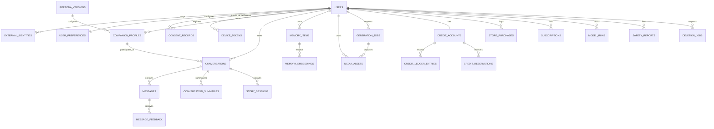

# Juhi — Database Design and Data Management Specification

**Document type:** Engineering database specification  
**Product:** Juhi AI Companion (girlfriend/boyfriend and customizable companion experiences)  
**Status:** Proposed baseline for implementation; confirm platform, legal, and billing details before production  
**Primary datastore:** Cloud SQL for PostgreSQL  
**Vector retrieval:** PostgreSQL + `pgvector` for the initial release  
**Binary media:** Private Google Cloud Storage buckets  
**Identity:** Firebase Authentication, mapped to Juhi's internal user ID  
**Related documents:** `Juhi_AI_Companion_PRD.md`, `Juhi_Design_System.md`, `architecture.md`

---

## 1. Purpose and scope

This document defines the database model, constraints, indexes, transactional requirements, lifecycle policies, and operational practices needed to build Juhi. It is intended to be used by backend engineers, mobile engineers, AI/memory engineers, platform engineers, QA, and security reviewers.

It covers:

- account identity, profile, preferences, consent, and devices;
- companion configuration, persona versions, relationship preferences, and boundaries;
- conversations, ordered messages, typed message content, summaries, and feedback;
- long-term memory, embeddings, provenance, scope separation, story state, and user controls;
- private image/audio assets and asynchronous generation jobs;
- credit accounting, reservations, subscriptions, store purchases, entitlements, and reconciliation;
- AI model-call telemetry, safety reports, support audit events, privacy export, and deletion workflows;
- schema migration, backup, recovery, testing, retention, and performance practices.

This is a proposed logical and physical design, not a statement that every table must ship in the first release. The MVP should implement the P0 tables and constraints first while keeping the schema extensible. Database objects must be added through reviewed, version-controlled migrations.

## 2. Design decisions

### 2.1 Source-of-truth boundaries

| Data | System of record | Notes |
|---|---|---|
| Account mapping and product data | PostgreSQL | Firebase provides authentication; PostgreSQL owns Juhi's internal account and app state. |
| Passwords and provider secrets | Managed identity / Secret Manager | Never store plaintext passwords, API keys, refresh tokens, or service-account keys in application tables. |
| Conversations and messages | PostgreSQL | Store structured text/content envelopes and references to media. Do not store binary audio or image bytes in SQL. |
| Memory metadata and initial embeddings | PostgreSQL + `pgvector` | Keep memory items independently inspectable, editable, and deletable. Consider a dedicated vector service only when measured needs justify it. |
| Image/audio bytes | Private Cloud Storage | PostgreSQL stores opaque object keys and metadata, not public permanent URLs. |
| Store purchase verification | PostgreSQL normalized records + verified store evidence | Backend verifies Google Play purchase state; clients never set their own subscription or balance. |
| Product analytics | Minimized event pipeline / warehouse | Avoid sending raw conversation text, sensitive memory, audio transcripts, or generated media to general analytics by default. |
| Runtime logs and traces | Approved observability system | Use opaque IDs and operational metadata; no raw message body by default. |

### 2.2 Core principles

1. **Internal IDs are canonical.** Every authenticated Firebase UID maps to an opaque Juhi `user_id`; all product tables reference that internal ID.
2. **Authorization is enforced on the server.** Queries over user-owned data must be scoped by the authenticated internal user ID. A client-submitted `user_id`, plan, credit balance, moderator result, or admin flag is not trusted.
3. **Use relational constraints for invariants.** Foreign keys, uniqueness, checks, and transactions must protect correctness even when requests are retried or multiple workers race.
4. **Separate real-life memory from fictional state.** A roleplay character's fictional history must never be silently persisted as a fact about the real user.
5. **Keep a provenance trail for memory.** Users must be able to inspect, correct, pin, pause, or delete retained memory. Store source references and confidence, not only generated text.
6. **Treat billing as a ledger.** Credit balances are server-authoritative and reconcilable from an append-only movement ledger. A generation retry must not double-charge a user.
7. **Use private media storage.** Access is granted through authenticated authorization and short-lived signed URLs or an authenticated proxy, not public buckets.
8. **Minimize sensitive data.** Store only the information required for product functionality, safety, legal obligations, or explicitly disclosed optional features.
9. **Make deletion a workflow.** Account deletion includes PostgreSQL, media objects, embeddings, queues, caches, and processor-specific retention/deletion pathways.
10. **Version structured AI data.** Every persisted JSON structure that is interpreted by code must have a schema version and validation.

### 2.3 MVP versus later

| Priority | Database capabilities |
|---|---|
| P0 — MVP | users, external identities, preferences, consent, companion profiles, persona versions, conversations, messages, summaries, memory items, media metadata, generation jobs, credit accounts/ledger/reservations, purchase/subscription/entitlement model, audit events, deletion jobs, basic model-run metadata. |
| P1 — Public launch | devices and notification preferences, message feedback, safety reports, voice transcript metadata, story state/event log, provider reconciliation, detailed usage/cost telemetry, user data export tracking. |
| P2 — Scale/advanced | partitioned message tables if needed, dedicated vector service, experiment assignments, advanced moderation evidence workflow, analytics outbox, advanced real-time-call session tables, regional retention controls. |

Do not create distributed databases, a separate event store, or a dedicated vector database solely to appear scalable. Start with a well-indexed PostgreSQL database and move only when measured data volume, query patterns, or isolation requirements demand it.

## 3. Platform and PostgreSQL conventions

### 3.1 Recommended baseline

- Managed PostgreSQL on Cloud SQL.
- Use a currently supported PostgreSQL major version selected with the infrastructure owner; pin and document the chosen engine version.
- Use `pgvector` for semantic memory retrieval if the chosen Cloud SQL version and extension availability support it.
- Use SQLAlchemy 2.x and Alembic migrations in the FastAPI backend.
- Use UUID primary keys generated by the application (`uuid4`/UUIDv7 where supported consistently) or a database-safe UUID function. UUIDs are identifiers, not authorization secrets.
- Store timestamps as `timestamptz` in UTC. Localized display time is derived using the user's timezone preference.
- Store monetary values as integer minor currency units or exact `numeric`, never binary floating point.
- Store credit quantities as integers when credits are indivisible. Use an explicit quantity scale if fractional credits become a published product feature.
- Use `jsonb` only for bounded, schema-validated payloads or provider-specific metadata—not as a substitute for core relational fields.
- Avoid PostgreSQL enum types for rapidly changing product states unless the team is willing to manage enum migrations. For many status values, use `text` plus `CHECK` constraints.
- Add `created_at` and `updated_at` to mutable domain records. Append-only ledgers and audit records should not have routine update paths.
- Never expose sequential database primary keys or internal object-storage paths to clients as authorization mechanisms.

### 3.2 Naming conventions

| Object | Convention | Example |
|---|---|---|
| Tables | plural `snake_case` | `memory_items` |
| Columns | `snake_case` | `source_message_id` |
| Primary key | `id UUID` unless a clear composite key is preferable | `id UUID PRIMARY KEY` |
| Foreign key | `<referenced_entity>_id` | `conversation_id` |
| Index | `ix_<table>_<columns_or_purpose>` | `ix_messages_conversation_sequence` |
| Unique index/constraint | `uq_<table>_<purpose>` | `uq_messages_conversation_sequence` |
| Check constraint | `ck_<table>_<purpose>` | `ck_memory_items_confidence` |
| Migration | timestamp/revision + readable label | `20261017_001_core_identity` |

### 3.3 Common columns

Mutable entities commonly include:

```sql
created_at timestamptz NOT NULL DEFAULT now(),
updated_at timestamptz NOT NULL DEFAULT now()
```

Set `updated_at` in application/service code or through a well-tested trigger. Do not rely on developers remembering to update it without an automated test. Append-only tables—such as `credit_ledger_entries`, `consent_records`, and `audit_events`—should have `created_at` only, with updates prohibited by application permissions and, for sensitive tables, a trigger or permissions policy.

### 3.4 Extension management

Apply only approved extensions in a migration or infrastructure bootstrap:

```sql
-- Optional and subject to Cloud SQL support/version approval:
CREATE EXTENSION IF NOT EXISTS vector;
-- Do not add extensions ad hoc in production. Record owner, purpose, and version.
```

The core transactional schema should remain usable if `pgvector` is temporarily unavailable. The embedding vector can be moved into a dedicated store later, but source memory records must remain authoritative in PostgreSQL.

## 4. Entity relationship overview



The full SQL below is a reference baseline. Split it into multiple Alembic migrations by domain rather than deploying it as one enormous initial migration. Review all foreign-key deletion behavior before production.

## 5. Identity, user profile, preferences, consent, and devices

### 5.1 `users`

Represents a Juhi account, not a Firebase account. Use an internal UUID so authentication vendors can change without rewriting every foreign key.

Key fields:
- `id`: canonical internal account ID.
- `status`: `active`, `suspended`, `deletion_pending`, or `deleted`.
- `display_name`: optional user-chosen display label; not necessarily a legal name.
- `preferred_language`: BCP-47-ish language tag such as `en`, `hi`, `ta`, `en-IN`; validate against supported choices and allow future additions.
- `timezone`: IANA timezone such as `Asia/Kolkata`.
- `birth_date`: **do not collect by default**. If age assurance is legally/product-required, retain the minimum proof/result needed; consider storing an age-band or verification result rather than a full birth date. Do not collect underage identity data without a reviewed legal and safety plan.
- `age_assurance_status`: controlled state with an evidence/reference field rather than broad collection of identity documents.
- timestamps and deletion marker.

### 5.2 `external_identities`

Maps authentication providers to the internal account. Store Firebase UID as `provider_subject`; do not store the full Firebase ID token.

Unique key: `(provider, provider_subject)`. A single user may have more than one linked provider if account linking is implemented safely.

### 5.3 `user_preferences`

Stores validated user-facing defaults such as UI language, reply language behavior, accessibility options, memory controls, image/voice preferences, notification choices, relationship tone, and content boundaries. Separate sensitive/legally significant consent into `consent_records`.

Use typed fields for frequently filtered preferences. Keep only less common UI configuration in versioned `settings_json`. Do not store hidden psychological inferences or sensitive traits without explicit purpose, transparency, and consent.

### 5.4 `consent_records`

Append-only consent history. A new action creates a new row; do not silently overwrite an earlier decision. Examples of purposes: `long_term_memory`, `push_notifications`, `optional_audio_retention`, `personalization`, or other documented data processing. Record the displayed notice version, action, timestamp, and capture channel.

Consent record history is not by itself proof that every processing operation is lawful; the product and legal team must map each purpose to a lawful basis and applicable local requirements.

### 5.5 `device_tokens` and `notification_preferences`

Store only current push tokens needed for delivery. Tokens can rotate or become invalid; update `last_seen_at`, mark invalid tokens inactive, and remove them when no longer needed. Notification preferences are user-controlled and category-specific. Notification payloads should not reveal private conversation content on a locked screen by default.

### 5.6 SQL: identity and user settings

```sql
CREATE TABLE users (
    id UUID PRIMARY KEY,
    status TEXT NOT NULL DEFAULT 'active'
        CHECK (status IN ('active', 'suspended', 'deletion_pending', 'deleted')),
    display_name TEXT,
    preferred_language TEXT NOT NULL DEFAULT 'en',
    timezone TEXT NOT NULL DEFAULT 'Asia/Kolkata',
    age_assurance_status TEXT NOT NULL DEFAULT 'unknown'
        CHECK (age_assurance_status IN ('unknown', 'pending', 'verified_adult', 'restricted', 'failed', 'not_required')),
    age_assurance_reference TEXT,
    deletion_requested_at timestamptz,
    deleted_at timestamptz,
    created_at timestamptz NOT NULL DEFAULT now(),
    updated_at timestamptz NOT NULL DEFAULT now(),
    CONSTRAINT ck_users_deletion_status CHECK (
        (status <> 'deleted' OR deleted_at IS NOT NULL)
    )
);

CREATE TABLE external_identities (
    id UUID PRIMARY KEY,
    user_id UUID NOT NULL REFERENCES users(id) ON DELETE RESTRICT,
    provider TEXT NOT NULL CHECK (provider IN ('firebase')),
    provider_subject TEXT NOT NULL,
    email_snapshot TEXT,
    email_verified BOOLEAN,
    linked_at timestamptz NOT NULL DEFAULT now(),
    last_authenticated_at timestamptz,
    UNIQUE (provider, provider_subject)
);
CREATE INDEX ix_external_identities_user ON external_identities(user_id);

CREATE TABLE user_preferences (
    user_id UUID PRIMARY KEY REFERENCES users(id) ON DELETE RESTRICT,
    ui_language TEXT NOT NULL DEFAULT 'en',
    preferred_reply_language TEXT NOT NULL DEFAULT 'match_user',
    code_switching_enabled BOOLEAN NOT NULL DEFAULT true,
    timezone TEXT NOT NULL DEFAULT 'Asia/Kolkata',
    theme_mode TEXT NOT NULL DEFAULT 'system'
        CHECK (theme_mode IN ('system', 'light', 'dark')),
    accessibility_json JSONB NOT NULL DEFAULT '{}'::jsonb,
    memory_enabled BOOLEAN NOT NULL DEFAULT true,
    memory_pause_until timestamptz,
    image_autoplay_enabled BOOLEAN NOT NULL DEFAULT false,
    voice_reply_mode TEXT NOT NULL DEFAULT 'off'
        CHECK (voice_reply_mode IN ('off', 'on_request', 'automatic')),
    relationship_preferences JSONB NOT NULL DEFAULT '{}'::jsonb,
    boundary_preferences JSONB NOT NULL DEFAULT '{}'::jsonb,
    settings_json JSONB NOT NULL DEFAULT '{}'::jsonb,
    schema_version INTEGER NOT NULL DEFAULT 1 CHECK (schema_version > 0),
    created_at timestamptz NOT NULL DEFAULT now(),
    updated_at timestamptz NOT NULL DEFAULT now()
);

CREATE TABLE consent_records (
    id UUID PRIMARY KEY,
    user_id UUID NOT NULL REFERENCES users(id) ON DELETE RESTRICT,
    purpose TEXT NOT NULL,
    decision TEXT NOT NULL CHECK (decision IN ('granted', 'withdrawn', 'declined')),
    notice_version TEXT NOT NULL,
    capture_channel TEXT NOT NULL CHECK (capture_channel IN ('app', 'web', 'support', 'system_migration')),
    metadata JSONB NOT NULL DEFAULT '{}'::jsonb,
    created_at timestamptz NOT NULL DEFAULT now()
);
CREATE INDEX ix_consent_records_user_purpose_time
    ON consent_records(user_id, purpose, created_at DESC);

CREATE TABLE notification_preferences (
    user_id UUID PRIMARY KEY REFERENCES users(id) ON DELETE RESTRICT,
    product_updates BOOLEAN NOT NULL DEFAULT false,
    companion_checkins BOOLEAN NOT NULL DEFAULT false,
    generation_completion BOOLEAN NOT NULL DEFAULT true,
    billing_updates BOOLEAN NOT NULL DEFAULT true,
    quiet_hours_start TIME,
    quiet_hours_end TIME,
    timezone TEXT NOT NULL DEFAULT 'Asia/Kolkata',
    updated_at timestamptz NOT NULL DEFAULT now(),
    CONSTRAINT ck_notification_quiet_hours_pair CHECK (
        (quiet_hours_start IS NULL AND quiet_hours_end IS NULL)
        OR (quiet_hours_start IS NOT NULL AND quiet_hours_end IS NOT NULL)
    )
);

CREATE TABLE device_tokens (
    id UUID PRIMARY KEY,
    user_id UUID NOT NULL REFERENCES users(id) ON DELETE RESTRICT,
    platform TEXT NOT NULL CHECK (platform IN ('android', 'ios', 'web')),
    token_hash TEXT NOT NULL,
    token_ciphertext BYTEA,
    app_version TEXT,
    device_label TEXT,
    active BOOLEAN NOT NULL DEFAULT true,
    last_seen_at timestamptz NOT NULL DEFAULT now(),
    invalidated_at timestamptz,
    created_at timestamptz NOT NULL DEFAULT now(),
    UNIQUE (platform, token_hash),
    CONSTRAINT ck_device_token_invalidation CHECK (active OR invalidated_at IS NOT NULL)
);
CREATE INDEX ix_device_tokens_user_active ON device_tokens(user_id) WHERE active = true;
```

**Implementation notes:** `token_hash` supports uniqueness and token lookup without needing a plaintext index. If the delivery service requires the raw FCM token, store it encrypted with controlled key access or use a strictly protected token field; never log it. The exact encryption/key management pattern must be validated with the platform team.

## 6. Companion profiles and persona versioning

### 6.1 Data model rationale

Juhi is a product family, not one hard-coded personality prompt. Separate:

- **persona definitions/versions**: product-authored defaults and versioned behavior config;
- **companion profiles**: a user's selected companion instance, name, appearance profile, voice preferences, personality sliders, and boundaries;
- **conversation persona snapshot**: the exact selected persona/profile version for reproducibility and support investigation.

Never modify a versioned persona definition in place after it has been used in production. Publish a new version. User-specific modifications remain in `companion_profiles` or a separate profile revision history, as product requirements dictate.

### 6.2 `persona_versions`

Stores a product-controlled companion persona's stable identity, allowed behavior, language guidance, style configuration, safety-policy compatibility, and lifecycle status. Keep system prompts and safety policies in a prompt-management system or versioned application config where appropriate; the database should store the version identifiers and necessary reviewed configuration, not a dumping ground for conflicting prompt fragments.

### 6.3 `companion_profiles`

Belongs to one user. It can refer to a selected persona version while containing safe customization overrides. Include a `visual_identity_id` or versioned JSON description if visual identity is required. Do not treat a visual prompt as a guarantee of identical output; store seed/reference asset metadata only when the provider and lawful data usage allow it.

```sql
CREATE TABLE persona_versions (
    id UUID PRIMARY KEY,
    persona_key TEXT NOT NULL,
    version INTEGER NOT NULL CHECK (version > 0),
    display_name TEXT NOT NULL,
    description TEXT,
    supported_languages TEXT[] NOT NULL DEFAULT ARRAY['en'],
    persona_config JSONB NOT NULL DEFAULT '{}'::jsonb,
    voice_config JSONB NOT NULL DEFAULT '{}'::jsonb,
    visual_identity_config JSONB NOT NULL DEFAULT '{}'::jsonb,
    safety_policy_version TEXT NOT NULL,
    status TEXT NOT NULL DEFAULT 'draft'
        CHECK (status IN ('draft', 'active', 'deprecated', 'disabled')),
    created_at timestamptz NOT NULL DEFAULT now(),
    published_at timestamptz,
    created_by TEXT,
    UNIQUE (persona_key, version)
);
CREATE INDEX ix_persona_versions_active ON persona_versions(persona_key, status);

CREATE TABLE companion_profiles (
    id UUID PRIMARY KEY,
    user_id UUID NOT NULL REFERENCES users(id) ON DELETE RESTRICT,
    persona_version_id UUID NOT NULL REFERENCES persona_versions(id) ON DELETE RESTRICT,
    display_name TEXT NOT NULL,
    companion_gender_presentation TEXT NOT NULL DEFAULT 'unspecified'
        CHECK (companion_gender_presentation IN ('feminine', 'masculine', 'androgynous', 'unspecified', 'custom')),
    relationship_mode TEXT NOT NULL DEFAULT 'companion'
        CHECK (relationship_mode IN ('companion', 'girlfriend', 'boyfriend', 'best_friend', 'roleplay', 'custom')),
    personality_overrides JSONB NOT NULL DEFAULT '{}'::jsonb,
    relationship_preferences JSONB NOT NULL DEFAULT '{}'::jsonb,
    boundaries JSONB NOT NULL DEFAULT '{}'::jsonb,
    visual_identity JSONB NOT NULL DEFAULT '{}'::jsonb,
    voice_preferences JSONB NOT NULL DEFAULT '{}'::jsonb,
    is_default BOOLEAN NOT NULL DEFAULT false,
    status TEXT NOT NULL DEFAULT 'active'
        CHECK (status IN ('active', 'archived', 'deleted')),
    schema_version INTEGER NOT NULL DEFAULT 1 CHECK (schema_version > 0),
    created_at timestamptz NOT NULL DEFAULT now(),
    updated_at timestamptz NOT NULL DEFAULT now(),
    UNIQUE (id, user_id)
);
CREATE INDEX ix_companion_profiles_user_status
    ON companion_profiles(user_id, status, updated_at DESC);
CREATE UNIQUE INDEX uq_companion_profiles_one_default
    ON companion_profiles(user_id) WHERE is_default = true AND status = 'active';
```

If user-editable persona revision history becomes necessary, add `companion_profile_revisions(id, companion_profile_id, revision_no, snapshot_json, created_at)` with a unique `(companion_profile_id, revision_no)`. Do not rely on the latest profile JSON to explain all historical conversations.

## 7. Conversations, messages, and summaries

### 7.1 Conversation ownership and sequence

A conversation belongs to exactly one user and one selected companion profile. Store `type` such as `chat`, `roleplay`, `journal`, or `voice_session`, and identify fictional `story_session_id` when the conversation is a story. Avoid storing relationship state only inside a conversation title or prompt.

For messages:

- `sequence_no` is unique within a conversation.
- The server assigns sequence numbers; a client may send an idempotency key but cannot choose authoritative sequence values.
- A user message may be in `accepted`, `processing`, `complete`, `failed`, or `redacted` state.
- Assistant output should be represented in the chat history only when safe to show; intermediate tool calls and hidden model reasoning must not be stored as user-visible assistant messages.
- Keep `content_json` schema-versioned, with explicit part types such as text, image asset reference, audio asset reference, transcript, sticker/GIF reference, or system-supported structured card.
- Media references must be validated against authenticated ownership before they are attached or read.
- Use an idempotency key for message-creation requests to prevent duplicate sends after a mobile reconnect.

### 7.2 Message content envelope

Example:

```json
{
  "schema_version": 1,
  "parts": [
    {"type": "text", "text": "I had a difficult day."},
    {"type": "image_asset", "asset_id": "c86196e0-9f2b-4b6c-b0a7-d199b8ce56d7", "alt_text": "A sunset near the sea"}
  ]
}
```

Rules:

- Validate JSON against a strict Pydantic/JSON Schema contract at the API boundary.
- Reject unsupported part types and unbounded nested data.
- Do not embed binary payloads, base64 images, provider secrets, internal safety prompts, or raw tool credentials.
- Prefer structured columns for fields used in query predicates. JSON is for the typed content payload, not all message metadata.
- Keep provider metadata on `model_runs` or safe job records rather than returning it in normal message JSON.

### 7.3 SQL: conversation core

```sql
CREATE TABLE conversations (
    id UUID PRIMARY KEY,
    user_id UUID NOT NULL REFERENCES users(id) ON DELETE RESTRICT,
    companion_profile_id UUID NOT NULL,
    title TEXT,
    conversation_type TEXT NOT NULL DEFAULT 'chat'
        CHECK (conversation_type IN ('chat', 'roleplay', 'journal', 'voice_session')),
    status TEXT NOT NULL DEFAULT 'active'
        CHECK (status IN ('active', 'archived', 'deleting', 'deleted')),
    active_persona_version_id UUID NOT NULL REFERENCES persona_versions(id) ON DELETE RESTRICT,
    story_session_id UUID,
    next_sequence_no BIGINT NOT NULL DEFAULT 1 CHECK (next_sequence_no > 0),
    last_message_at timestamptz,
    metadata JSONB NOT NULL DEFAULT '{}'::jsonb,
    schema_version INTEGER NOT NULL DEFAULT 1 CHECK (schema_version > 0),
    created_at timestamptz NOT NULL DEFAULT now(),
    updated_at timestamptz NOT NULL DEFAULT now(),
    CONSTRAINT fk_conversation_companion_owner
        FOREIGN KEY (companion_profile_id, user_id)
        REFERENCES companion_profiles(id, user_id) ON DELETE RESTRICT,
    UNIQUE (id, user_id)
);
CREATE INDEX ix_conversations_user_recent
    ON conversations(user_id, status, last_message_at DESC NULLS LAST, id);
CREATE INDEX ix_conversations_companion ON conversations(companion_profile_id, created_at DESC);

CREATE TABLE messages (
    id UUID PRIMARY KEY,
    conversation_id UUID NOT NULL REFERENCES conversations(id) ON DELETE RESTRICT,
    sequence_no BIGINT NOT NULL CHECK (sequence_no > 0),
    role TEXT NOT NULL CHECK (role IN ('user', 'assistant', 'system_notice', 'tool_result')),
    status TEXT NOT NULL DEFAULT 'complete'
        CHECK (status IN ('accepted', 'processing', 'complete', 'failed', 'redacted', 'deleted')),
    content_json JSONB NOT NULL,
    content_schema_version INTEGER NOT NULL DEFAULT 1 CHECK (content_schema_version > 0),
    language_detected TEXT,
    client_message_id TEXT,
    idempotency_key TEXT NOT NULL,
    request_id UUID,
    reply_to_message_id UUID REFERENCES messages(id) ON DELETE SET NULL,
    model_run_id UUID,
    safety_state TEXT NOT NULL DEFAULT 'not_checked'
        CHECK (safety_state IN ('not_checked', 'allowed', 'transformed', 'blocked', 'review_required')),
    token_usage_json JSONB NOT NULL DEFAULT '{}'::jsonb,
    failure_code TEXT,
    accepted_at timestamptz NOT NULL DEFAULT now(),
    completed_at timestamptz,
    created_at timestamptz NOT NULL DEFAULT now(),
    UNIQUE (conversation_id, sequence_no),
    UNIQUE (conversation_id, idempotency_key)
);
CREATE INDEX ix_messages_conversation_sequence
    ON messages(conversation_id, sequence_no DESC);
CREATE INDEX ix_messages_request ON messages(request_id) WHERE request_id IS NOT NULL;
CREATE INDEX ix_messages_created_at ON messages(created_at DESC);

CREATE TABLE conversation_summaries (
    id UUID PRIMARY KEY,
    conversation_id UUID NOT NULL REFERENCES conversations(id) ON DELETE RESTRICT,
    version INTEGER NOT NULL CHECK (version > 0),
    summary_kind TEXT NOT NULL DEFAULT 'rolling'
        CHECK (summary_kind IN ('rolling', 'session_close', 'recovery', 'user_requested')),
    summary_text TEXT NOT NULL,
    from_sequence_no BIGINT NOT NULL CHECK (from_sequence_no > 0),
    through_sequence_no BIGINT NOT NULL CHECK (through_sequence_no >= from_sequence_no),
    model_key TEXT,
    prompt_version TEXT,
    schema_version INTEGER NOT NULL DEFAULT 1 CHECK (schema_version > 0),
    created_at timestamptz NOT NULL DEFAULT now(),
    UNIQUE (conversation_id, version)
);
CREATE INDEX ix_conversation_summaries_latest
    ON conversation_summaries(conversation_id, version DESC);

CREATE TABLE message_feedback (
    id UUID PRIMARY KEY,
    user_id UUID NOT NULL REFERENCES users(id) ON DELETE RESTRICT,
    message_id UUID NOT NULL REFERENCES messages(id) ON DELETE RESTRICT,
    rating TEXT NOT NULL CHECK (rating IN ('helpful', 'not_helpful', 'wrong_memory', 'wrong_tone', 'unsafe', 'other')),
    note TEXT,
    created_at timestamptz NOT NULL DEFAULT now(),
    UNIQUE (user_id, message_id, rating)
);
CREATE INDEX ix_message_feedback_user_time ON message_feedback(user_id, created_at DESC);
```

**Important integrity enhancement:** PostgreSQL cannot declare a foreign key from `messages` to `conversations` that proves the current user owns a message because `messages` does not repeat `user_id`. This is intentional normalization. Every message lookup must join through `conversations` and enforce the authenticated owner. If query ergonomics later require denormalizing `user_id` onto messages, add a composite FK `(conversation_id, user_id)` referencing a unique `(id, user_id)` key on conversations, and update every write path to preserve the invariant. Do not add duplicate ownership columns casually.

### 7.4 Allocating sequence numbers safely

Do not use `SELECT MAX(sequence_no) + 1` without locking. One implementation is:

1. Start a database transaction.
2. `SELECT id, next_sequence_no FROM conversations WHERE id=:id AND user_id=:user_id FOR UPDATE`.
3. Use the returned `next_sequence_no` to insert the message.
4. Increment `conversations.next_sequence_no` and update `last_message_at`.
5. Commit.

For idempotent retries, first look up `(conversation_id, idempotency_key)` and return the existing message if it is already present. The unique constraint is the final defense against races.

### 7.5 Conversation deletion

Use an explicit deletion workflow to remove messages, summaries, and referenced derivatives. Avoid broad `ON DELETE CASCADE` for high-value private content when asynchronous object deletion is required. During deletion, mark conversation `deleting`, deny new writes, enqueue object/embedding deletion work, remove child records in bounded batches, then mark `deleted` or remove identifying rows according to the approved retention policy.

## 8. Long-term memory and semantic retrieval

### 8.1 Memory taxonomy

Recommended initial `memory_type` values include:

- `preference` — stable interaction or content preference;
- `profile_fact` — a user-provided detail useful for continuity;
- `important_person` — a user-described relationship fact, only when useful and appropriately handled;
- `goal` — an ongoing goal or project the user explicitly discusses;
- `event` — a time-bounded fact or commitment;
- `boundary` — user-defined interaction boundaries;
- `correction` — explicit correction to an earlier memory;
- `conversation_summary` — an explicitly defined summary object if needed, though conversation summaries should remain separately identifiable;
- `story_fact` — fictional state that must be scoped to a story session and never treated as real-world fact.

Prefer stable, minimal memory statements over speculative personality inferences. Never silently infer or persist sensitive traits, medical diagnoses, political beliefs, religious identity, sexual details, or other sensitive attributes for personalization without a defined, reviewed purpose and valid consent. The companion should not manufacture memories from assistant-generated claims.

### 8.2 Required memory attributes

Each memory item should have:

- user ownership;
- memory type and scope (`real_life`, `story`, `interaction_preference`);
- text/content and optional typed attributes;
- source conversation/message references where applicable;
- extraction method/version, confidence, and source role;
- sensitivity classification and user visibility;
- status (`active`, `paused`, `superseded`, `deleted`, `expired`);
- explicit `user_confirmed` state for important facts where confirmation is required;
- importance and recency signals used for ranking;
- optional expiry time;
- a revision mechanism or supersession relation.

Memory extraction is asynchronous and fallible. Never make an external response depend on a memory write succeeding. Retrieve memory through an access-controlled service, apply scope and sensitivity filters, and format it into a bounded context budget.

### 8.3 SQL: memory and embeddings

```sql
CREATE TABLE memory_items (
    id UUID PRIMARY KEY,
    user_id UUID NOT NULL REFERENCES users(id) ON DELETE RESTRICT,
    companion_profile_id UUID,
    conversation_id UUID REFERENCES conversations(id) ON DELETE RESTRICT,
    source_message_id UUID REFERENCES messages(id) ON DELETE RESTRICT,
    supersedes_memory_id UUID REFERENCES memory_items(id) ON DELETE SET NULL,
    memory_type TEXT NOT NULL CHECK (memory_type IN (
        'preference', 'profile_fact', 'important_person', 'goal', 'event',
        'boundary', 'correction', 'story_fact', 'other'
    )),
    scope TEXT NOT NULL DEFAULT 'real_life'
        CHECK (scope IN ('real_life', 'interaction_preference', 'story')),
    story_session_id UUID,
    content_text TEXT NOT NULL,
    attributes JSONB NOT NULL DEFAULT '{}'::jsonb,
    source_kind TEXT NOT NULL CHECK (source_kind IN (
        'user_statement', 'user_confirmed', 'conversation_extraction',
        'user_edit', 'imported_by_user', 'system_migration'
    )),
    extraction_version TEXT,
    confidence NUMERIC(4,3) CHECK (confidence IS NULL OR confidence BETWEEN 0 AND 1),
    importance SMALLINT NOT NULL DEFAULT 3 CHECK (importance BETWEEN 1 AND 5),
    sensitivity TEXT NOT NULL DEFAULT 'normal'
        CHECK (sensitivity IN ('normal', 'sensitive', 'restricted')),
    status TEXT NOT NULL DEFAULT 'active'
        CHECK (status IN ('active', 'paused', 'superseded', 'deleted', 'expired')),
    user_visible BOOLEAN NOT NULL DEFAULT true,
    user_confirmed BOOLEAN NOT NULL DEFAULT false,
    valid_from timestamptz,
    expires_at timestamptz,
    superseded_at timestamptz,
    revision INTEGER NOT NULL DEFAULT 1 CHECK (revision > 0),
    created_at timestamptz NOT NULL DEFAULT now(),
    updated_at timestamptz NOT NULL DEFAULT now(),
    deleted_at timestamptz,
    CONSTRAINT ck_memory_scope_story CHECK (
        (scope = 'story' AND story_session_id IS NOT NULL)
        OR (scope <> 'story' AND story_session_id IS NULL)
    ),
    CONSTRAINT ck_memory_deleted_timestamp CHECK (
        (status <> 'deleted') OR deleted_at IS NOT NULL
    ),
    CONSTRAINT fk_memory_companion_owner
        FOREIGN KEY (companion_profile_id, user_id)
        REFERENCES companion_profiles(id, user_id) ON DELETE RESTRICT,
    CONSTRAINT fk_memory_conversation_owner
        FOREIGN KEY (conversation_id, user_id)
        REFERENCES conversations(id, user_id) ON DELETE RESTRICT,
    UNIQUE (id, user_id)
);
CREATE INDEX ix_memory_items_user_active_type
    ON memory_items(user_id, status, memory_type, updated_at DESC)
    WHERE status = 'active';
CREATE INDEX ix_memory_items_user_scope
    ON memory_items(user_id, scope, story_session_id, status);
CREATE INDEX ix_memory_items_source_message
    ON memory_items(source_message_id) WHERE source_message_id IS NOT NULL;
CREATE INDEX ix_memory_items_expiry
    ON memory_items(expires_at) WHERE expires_at IS NOT NULL AND status = 'active';
CREATE INDEX ix_memory_items_attributes_gin ON memory_items USING GIN(attributes);

-- Optional: choose embedding dimensions to match the selected embedding model.
-- Do not assume this 1536-dimensional example fits every provider.
CREATE TABLE memory_embeddings (
    id UUID PRIMARY KEY,
    memory_item_id UUID NOT NULL,
    user_id UUID NOT NULL REFERENCES users(id) ON DELETE RESTRICT,
    embedding_model TEXT NOT NULL,
    embedding_version TEXT NOT NULL,
    embedding vector(1536) NOT NULL,
    content_hash TEXT NOT NULL,
    status TEXT NOT NULL DEFAULT 'active'
        CHECK (status IN ('active', 'stale', 'deleted')),
    created_at timestamptz NOT NULL DEFAULT now(),
    UNIQUE (memory_item_id, embedding_model, embedding_version, content_hash),
    FOREIGN KEY (memory_item_id, user_id)
        REFERENCES memory_items(id, user_id) ON DELETE RESTRICT
);
CREATE INDEX ix_memory_embeddings_user ON memory_embeddings(user_id, status);
-- Add an ANN index only after validating dataset size, recall, and query shape.
-- Example HNSW index; confirm pgvector/index-method support in the target engine:
-- CREATE INDEX ix_memory_embeddings_hnsw ON memory_embeddings
-- USING hnsw (embedding vector_cosine_ops) WHERE status = 'active';
```

**Vector dimension rule:** `vector(1536)` is an example only. If different embedding models produce different dimensions, do not mix vectors in the same fixed-dimension column. Use separate columns/tables per model family or migrate to a deliberately chosen dimension. Persist model and version metadata, and re-embed records when an embedding model changes. Revoke/rebuild embeddings whenever source content is edited or deleted.

**Tenant isolation:** Add `user_id` to `memory_embeddings` for efficient pre-filtering, but preserve consistency with `memory_items`. Validate the pair in application code or add a composite foreign key using a unique `(id, user_id)` key on `memory_items`. Every retrieval query must scope to the authenticated user and the permitted story/scope. Never run global nearest-neighbor retrieval and filter ownership only after returning results to the application if that can expose cross-user content.

### 8.4 Memory revisions and user actions

There are two workable patterns:

1. **In-place editing with audit event:** update the current row, increment `revision`, regenerate the embedding, and append a restricted audit record with action/time and field-level change category (not necessarily the old sensitive text).
2. **Immutable revisions:** add `memory_revisions(memory_item_id, revision, content snapshot, editor, timestamp)` and point `memory_items` at the current revision.

Choose one pattern before shipping the memory editor. The in-place pattern is simpler; the immutable pattern offers better history but makes privacy deletion and storage minimization more complex. Even if memory content is revised, do not keep content backups indefinitely after an explicit delete.

### 8.5 Retrieval strategy

Initial hybrid retrieval can combine:

- explicit pinned/confirmed memory;
- exact keyword and PostgreSQL full-text search;
- semantic similarity using `pgvector`;
- recency, importance, confidence, scope and user-confirmation features;
- exclusion filters for deleted, expired, paused, superseded, restricted, or story-incompatible memory.

Store retrieval analytics in a minimized form (IDs and scores where appropriate), not a second copy of the entire prompt. Evaluate retrieval quality separately from generation quality. Guard against stale or contradictory memory by preferring newer explicit corrections and marking superseded entries.

## 9. Story / roleplay state isolation

Story mode requires a separate storage scope so fictional events remain fictional. A story session can have a structured state, event log and rolling summary. Do not use assistant-written fictional events to update real-life profile facts. The user must be able to reset or delete story state independently of real-life memory.

```sql
CREATE TABLE story_sessions (
    id UUID PRIMARY KEY,
    user_id UUID NOT NULL REFERENCES users(id) ON DELETE RESTRICT,
    companion_profile_id UUID NOT NULL,
    conversation_id UUID REFERENCES conversations(id) ON DELETE RESTRICT,
    title TEXT,
    genre TEXT,
    state_json JSONB NOT NULL DEFAULT '{}'::jsonb,
    state_schema_version INTEGER NOT NULL DEFAULT 1 CHECK (state_schema_version > 0),
    status TEXT NOT NULL DEFAULT 'active'
        CHECK (status IN ('active', 'paused', 'completed', 'reset', 'deleted')),
    created_at timestamptz NOT NULL DEFAULT now(),
    updated_at timestamptz NOT NULL DEFAULT now(),
    FOREIGN KEY (companion_profile_id, user_id)
        REFERENCES companion_profiles(id, user_id) ON DELETE RESTRICT,
    UNIQUE (id, user_id)
);
CREATE INDEX ix_story_sessions_user_status ON story_sessions(user_id, status, updated_at DESC);

CREATE TABLE story_events (
    id UUID PRIMARY KEY,
    story_session_id UUID NOT NULL REFERENCES story_sessions(id) ON DELETE RESTRICT,
    sequence_no BIGINT NOT NULL CHECK (sequence_no > 0),
    event_type TEXT NOT NULL,
    state_delta JSONB NOT NULL DEFAULT '{}'::jsonb,
    source_message_id UUID REFERENCES messages(id) ON DELETE RESTRICT,
    created_at timestamptz NOT NULL DEFAULT now(),
    UNIQUE (story_session_id, sequence_no)
);
CREATE INDEX ix_story_events_session_sequence
    ON story_events(story_session_id, sequence_no DESC);
```

The `conversations.story_session_id` relationship should be added after `story_sessions` exists, via a later migration and a validated foreign key. Because both tables refer to each other conceptually, migrations should create one side first and add the optional FK afterward. Ensure `story_session_id` belongs to the same user as the conversation; enforce with a composite `(story_session_id, user_id)` foreign key if `user_id` is added to conversations, or validate under a transaction in the service layer.

## 10. Media assets and generation jobs

### 10.1 Storage model

PostgreSQL retains metadata, ownership, processing status, moderation result, expiration/deletion data, and the object key. Private Cloud Storage stores binary data. Never use the storage object's URL as the authorization check. Signed URLs should be short-lived and minted only after the API verifies ownership and policy.

Use opaque storage keys, for example:

`users/<opaque-user-id>/assets/<opaque-asset-id>/<object-version>`

Avoid user names, email addresses, message content, or sensitive details in bucket/object names. Bucket layout is an operational detail; the database should store the canonical `object_key` and `storage_bucket` only when required.

### 10.2 `media_assets`

Supports user uploads and generated content. Track type, MIME type, size, dimensions/duration, processing status, access policy, moderation state, retention and deletion status. For generated companion imagery, link to the generation job and versioned visual identity config where available. Keep prompts in a separate access-controlled field/table only if they are needed for product functionality or abuse investigation; do not expose prompt text in ordinary media-list APIs.

### 10.3 `generation_jobs`

Represents expensive asynchronous work such as image creation, speech synthesis, speech recognition, voice reply, or other media generation. Jobs need:

- an idempotency key scoped to the user;
- a server-controlled state machine;
- bounded retries and lease/heartbeat information;
- a link to the credit reservation;
- request and model/config versions;
- error classification and sanitized provider reference;
- timestamps for queue, start, finish, and expiration.

The client must never decide a job's success, cost, moderation outcome or final credit charge.

### 10.4 SQL: media and jobs

```sql
CREATE TABLE media_assets (
    id UUID PRIMARY KEY,
    user_id UUID NOT NULL REFERENCES users(id) ON DELETE RESTRICT,
    conversation_id UUID REFERENCES conversations(id) ON DELETE RESTRICT,
    message_id UUID REFERENCES messages(id) ON DELETE RESTRICT,
    generation_job_id UUID,
    asset_kind TEXT NOT NULL CHECK (asset_kind IN (
        'image', 'audio', 'video', 'sticker', 'gif', 'attachment', 'thumbnail'
    )),
    origin TEXT NOT NULL CHECK (origin IN ('user_upload', 'ai_generated', 'licensed_external', 'system')),
    storage_bucket TEXT NOT NULL,
    object_key TEXT NOT NULL,
    object_generation TEXT,
    mime_type TEXT NOT NULL,
    byte_size BIGINT NOT NULL CHECK (byte_size >= 0),
    width_px INTEGER CHECK (width_px IS NULL OR width_px > 0),
    height_px INTEGER CHECK (height_px IS NULL OR height_px > 0),
    duration_ms BIGINT CHECK (duration_ms IS NULL OR duration_ms >= 0),
    sha256_hex TEXT,
    processing_status TEXT NOT NULL DEFAULT 'pending'
        CHECK (processing_status IN ('pending', 'scanning', 'ready', 'failed', 'deleting', 'deleted')),
    moderation_status TEXT NOT NULL DEFAULT 'pending'
        CHECK (moderation_status IN ('pending', 'allowed', 'blocked', 'review_required', 'not_applicable')),
    visibility TEXT NOT NULL DEFAULT 'private'
        CHECK (visibility IN ('private', 'shared_by_user', 'public_opt_in')),
    retention_class TEXT NOT NULL DEFAULT 'user_content',
    expires_at timestamptz,
    deleted_at timestamptz,
    metadata JSONB NOT NULL DEFAULT '{}'::jsonb,
    created_at timestamptz NOT NULL DEFAULT now(),
    updated_at timestamptz NOT NULL DEFAULT now(),
    UNIQUE (storage_bucket, object_key),
    CONSTRAINT ck_media_deleted_state CHECK (
        (processing_status <> 'deleted') OR deleted_at IS NOT NULL
    ),
    CONSTRAINT fk_media_conversation_owner
        FOREIGN KEY (conversation_id, user_id)
        REFERENCES conversations(id, user_id) ON DELETE RESTRICT
);
CREATE INDEX ix_media_assets_user_recent
    ON media_assets(user_id, created_at DESC) WHERE processing_status <> 'deleted';
CREATE INDEX ix_media_assets_conversation ON media_assets(conversation_id, created_at);
CREATE INDEX ix_media_assets_expiry
    ON media_assets(expires_at) WHERE expires_at IS NOT NULL AND processing_status <> 'deleted';
CREATE INDEX ix_media_assets_generation_job
    ON media_assets(generation_job_id) WHERE generation_job_id IS NOT NULL;

CREATE TABLE generation_jobs (
    id UUID PRIMARY KEY,
    user_id UUID NOT NULL REFERENCES users(id) ON DELETE RESTRICT,
    conversation_id UUID REFERENCES conversations(id) ON DELETE RESTRICT,
    source_message_id UUID REFERENCES messages(id) ON DELETE RESTRICT,
    job_type TEXT NOT NULL CHECK (job_type IN (
        'image_generation', 'speech_to_text', 'text_to_speech', 'voice_reply',
        'video_generation', 'media_processing', 'embedding', 'other'
    )),
    status TEXT NOT NULL DEFAULT 'queued'
        CHECK (status IN ('queued', 'reserved', 'running', 'succeeded', 'failed', 'cancel_requested', 'cancelled', 'expired')),
    idempotency_key TEXT NOT NULL,
    credit_reservation_id UUID,
    request_config JSONB NOT NULL DEFAULT '{}'::jsonb,
    request_schema_version INTEGER NOT NULL DEFAULT 1 CHECK (request_schema_version > 0),
    provider_key TEXT,
    provider_model TEXT,
    provider_request_ref TEXT,
    attempt_count INTEGER NOT NULL DEFAULT 0 CHECK (attempt_count >= 0),
    max_attempts INTEGER NOT NULL DEFAULT 2 CHECK (max_attempts BETWEEN 1 AND 10),
    queued_at timestamptz NOT NULL DEFAULT now(),
    started_at timestamptz,
    heartbeat_at timestamptz,
    completed_at timestamptz,
    expires_at timestamptz,
    error_code TEXT,
    error_category TEXT,
    safe_error_message TEXT,
    result_json JSONB NOT NULL DEFAULT '{}'::jsonb,
    created_at timestamptz NOT NULL DEFAULT now(),
    updated_at timestamptz NOT NULL DEFAULT now(),
    UNIQUE (user_id, idempotency_key),
    CONSTRAINT ck_generation_attempts CHECK (attempt_count <= max_attempts),
    CONSTRAINT fk_generation_job_conversation_owner
        FOREIGN KEY (conversation_id, user_id)
        REFERENCES conversations(id, user_id) ON DELETE RESTRICT
);
CREATE INDEX ix_generation_jobs_queue ON generation_jobs(status, queued_at)
    WHERE status IN ('queued', 'reserved', 'running', 'cancel_requested');
CREATE INDEX ix_generation_jobs_user_recent ON generation_jobs(user_id, created_at DESC);
CREATE INDEX ix_generation_jobs_stale_heartbeat ON generation_jobs(heartbeat_at)
    WHERE status = 'running';
```

After all relevant domain tables exist, add the following cross-domain foreign keys in a follow-up Alembic migration: `media_assets.generation_job_id → generation_jobs.id`, `generation_jobs.credit_reservation_id → credit_reservations.id`, and `messages.model_run_id → model_runs.id` (using `ON DELETE SET NULL` only if deleting that model-run row is an approved behavior; otherwise retain it with `RESTRICT`). This ordering avoids forward-reference problems while preserving referential integrity. For auditability, a provider request reference should be stored only when allowed by provider terms and should not contain secrets.

### 10.5 Job state machine and transactional billing

Expected lifecycle:

`queued → reserved → running → succeeded`

Failure/cancellation paths:

- `queued → cancelled` if cancellation occurs before reservation/start;
- `reserved/running → failed` followed by releasing the reservation when the provider did not produce a chargeable result;
- `running → succeeded` followed by settlement based on the published tariff and actual accepted result;
- `running → cancel_requested → cancelled` where provider cancellation is supported;
- `queued/running → expired` for jobs exceeding an explicit timeout/lease policy.

Use an idempotency key to ensure retries reuse one logical job. A worker must claim a job atomically, increment attempts transactionally, and only transition from allowed prior states. A timeout does not necessarily mean the provider did not process a request; reconcile provider outcomes before refunding to avoid duplicate outputs or double settlement.

## 11. Billing, subscriptions, entitlements, and credit ledger

### 11.1 Non-negotiable invariants

- The backend verifies all app-store purchases and controls entitlements.
- The client only displays entitlement and credit balance returned by the backend.
- Every credit-changing request is idempotent.
- Credit reservations and final settlement occur in database transactions.
- Failed jobs release reservations according to published product policy; post-settlement refunds create a new ledger event rather than changing historical entries.
- Subscription state is derived from verified store events and reconciliation, not the client receipt alone.
- Juhi must not store payment card data. Keep store purchase tokens/references only as required for verification and handle them as sensitive data.
- `product_catalog` describes sellable products, while `entitlements` records effective access; do not infer access only from the most recent purchase row.

### 11.2 Model tables

Recommended tables:

- `product_catalog`: server-authored product identifiers, product type and configuration version;
- `store_purchases`: normalized purchase/transaction records with unique store transaction identifiers;
- `purchase_events`: append-only sanitized provider/store notifications and reconciliation state;
- `subscriptions`: current materialized subscription state per store subscription chain;
- `entitlements`: effective capability access with start/end/status and source reference;
- `credit_accounts`: a transactionally maintained balance snapshot for fast reads;
- `credit_reservations`: one provisional reservation per operation;
- `credit_ledger_entries`: immutable movements reconcilable to the account snapshot;
- optional `usage_events`: product/model usage metrics distinct from credit accounting.

### 11.3 Credits and accounting semantics

Let `available_balance` be spendable credits and `reserved_balance` be credits held by in-flight work. Each ledger row has two signed movements: `available_delta` and `reserved_delta`.

| Event | `available_delta` | `reserved_delta` | Meaning |
|---|---:|---:|---|
| Grant | `+N` | `0` | Credit added (purchase, plan grant, promo). |
| Reserve | `-N` | `+N` | Hold estimated cost before expensive work. |
| Settle | `0` | `-N` | Consume previously reserved N credits after success. |
| Release | `+N` | `-N` | Return reserved credits after a non-chargeable outcome. |
| Refund | `+N` | `0` | Refund previously settled credits under policy. |
| Expire | `-N` | `0` | Expire eligible credits only under the published policy and appropriate lot/expiry logic. |
| Adjustment | `±N` | typically `0` | Audited support correction with actor and reason. |

This movement model tracks current balances but does not, by itself, determine which credits expire first. If credits have different expiries (e.g. purchased versus promotional), add credit lots and allocation tables before shipping expiry. Do not implement an ambiguous global expiry that silently consumes purchased credits.

### 11.4 SQL: catalog, purchases, subscriptions and entitlements

```sql
CREATE TABLE product_catalog (
    id UUID PRIMARY KEY,
    product_key TEXT NOT NULL UNIQUE,
    store_product_id TEXT,
    product_type TEXT NOT NULL CHECK (product_type IN ('subscription', 'credit_pack', 'one_time_unlock', 'promo')),
    display_config JSONB NOT NULL DEFAULT '{}'::jsonb,
    entitlement_config JSONB NOT NULL DEFAULT '{}'::jsonb,
    credit_amount INTEGER CHECK (credit_amount IS NULL OR credit_amount >= 0),
    currency CHAR(3),
    price_minor BIGINT CHECK (price_minor IS NULL OR price_minor >= 0),
    tariff_version TEXT NOT NULL,
    active BOOLEAN NOT NULL DEFAULT false,
    valid_from timestamptz,
    valid_until timestamptz,
    created_at timestamptz NOT NULL DEFAULT now(),
    updated_at timestamptz NOT NULL DEFAULT now()
);
CREATE INDEX ix_product_catalog_active ON product_catalog(product_type, active);

CREATE TABLE store_purchases (
    id UUID PRIMARY KEY,
    user_id UUID NOT NULL REFERENCES users(id) ON DELETE RESTRICT,
    store TEXT NOT NULL CHECK (store IN ('google_play', 'apple_app_store', 'web', 'admin_grant')),
    product_catalog_id UUID REFERENCES product_catalog(id) ON DELETE RESTRICT,
    store_product_id TEXT NOT NULL,
    transaction_id TEXT,
    original_transaction_id TEXT,
    purchase_token_ciphertext BYTEA,
    purchase_token_hash TEXT,
    purchase_state TEXT NOT NULL DEFAULT 'pending'
        CHECK (purchase_state IN ('pending', 'verified', 'rejected', 'refunded', 'revoked', 'expired', 'unknown')),
    purchased_at timestamptz,
    acknowledged_at timestamptz,
    verified_at timestamptz,
    expires_at timestamptz,
    environment TEXT,
    verification_reference TEXT,
    verification_payload_hash TEXT,
    last_reconciled_at timestamptz,
    created_at timestamptz NOT NULL DEFAULT now(),
    updated_at timestamptz NOT NULL DEFAULT now(),
    CONSTRAINT ck_store_purchase_transaction CHECK (
        transaction_id IS NOT NULL OR purchase_token_hash IS NOT NULL
    ),
    UNIQUE (id, user_id)
);
CREATE UNIQUE INDEX uq_store_purchase_transaction
    ON store_purchases(store, transaction_id) WHERE transaction_id IS NOT NULL;
CREATE UNIQUE INDEX uq_store_purchase_token
    ON store_purchases(store, purchase_token_hash) WHERE purchase_token_hash IS NOT NULL;
CREATE INDEX ix_store_purchases_user_time ON store_purchases(user_id, created_at DESC);
CREATE INDEX ix_store_purchases_reconcile ON store_purchases(last_reconciled_at)
    WHERE purchase_state IN ('pending', 'verified');

CREATE TABLE purchase_events (
    id UUID PRIMARY KEY,
    store TEXT NOT NULL,
    store_event_id TEXT NOT NULL,
    store_purchase_id UUID REFERENCES store_purchases(id) ON DELETE RESTRICT,
    event_type TEXT NOT NULL,
    event_time timestamptz,
    received_at timestamptz NOT NULL DEFAULT now(),
    verification_status TEXT NOT NULL DEFAULT 'pending'
        CHECK (verification_status IN ('pending', 'verified', 'rejected', 'duplicate', 'error')),
    payload_hash TEXT NOT NULL,
    safe_payload JSONB NOT NULL DEFAULT '{}'::jsonb,
    processed_at timestamptz,
    error_code TEXT,
    UNIQUE (store, store_event_id)
);
CREATE INDEX ix_purchase_events_unprocessed ON purchase_events(received_at)
    WHERE processed_at IS NULL;

CREATE TABLE subscriptions (
    id UUID PRIMARY KEY,
    user_id UUID NOT NULL REFERENCES users(id) ON DELETE RESTRICT,
    store_purchase_id UUID REFERENCES store_purchases(id) ON DELETE RESTRICT,
    store TEXT NOT NULL,
    store_subscription_key TEXT NOT NULL,
    product_catalog_id UUID REFERENCES product_catalog(id) ON DELETE RESTRICT,
    status TEXT NOT NULL CHECK (status IN (
        'pending', 'active', 'grace_period', 'paused', 'cancelled', 'expired', 'revoked', 'on_hold'
    )),
    started_at timestamptz,
    current_period_start timestamptz,
    current_period_end timestamptz,
    auto_renew BOOLEAN,
    last_verified_at timestamptz,
    provider_state JSONB NOT NULL DEFAULT '{}'::jsonb,
    created_at timestamptz NOT NULL DEFAULT now(),
    updated_at timestamptz NOT NULL DEFAULT now(),
    UNIQUE (store, store_subscription_key),
    FOREIGN KEY (store_purchase_id, user_id)
        REFERENCES store_purchases(id, user_id) ON DELETE RESTRICT
);
CREATE INDEX ix_subscriptions_user_status ON subscriptions(user_id, status, current_period_end DESC);

CREATE TABLE entitlements (
    id UUID PRIMARY KEY,
    user_id UUID NOT NULL REFERENCES users(id) ON DELETE RESTRICT,
    entitlement_key TEXT NOT NULL,
    source_type TEXT NOT NULL CHECK (source_type IN ('subscription', 'purchase', 'promotion', 'support_adjustment')),
    source_id UUID,
    status TEXT NOT NULL CHECK (status IN ('active', 'scheduled', 'expired', 'revoked')),
    starts_at timestamptz NOT NULL,
    ends_at timestamptz,
    limits_json JSONB NOT NULL DEFAULT '{}'::jsonb,
    created_at timestamptz NOT NULL DEFAULT now(),
    updated_at timestamptz NOT NULL DEFAULT now(),
    CONSTRAINT ck_entitlement_period CHECK (ends_at IS NULL OR ends_at > starts_at)
);
CREATE INDEX ix_entitlements_user_current
    ON entitlements(user_id, entitlement_key, status, starts_at, ends_at);
```

**Store payload policy:** Do not blindly persist full store notification payloads if they contain unnecessary identifiers. Store a cryptographic payload hash and a normalized subset for reconciliation. If a receipt/purchase token must be retained for ongoing validation, encrypt it, limit access, and define an explicit retention window. Protect verification references from appearing in logs.

### 11.5 SQL: credit account, reservations and ledger

```sql
CREATE TABLE credit_accounts (
    id UUID PRIMARY KEY,
    user_id UUID NOT NULL REFERENCES users(id) ON DELETE RESTRICT,
    credit_unit TEXT NOT NULL DEFAULT 'credits',
    available_balance BIGINT NOT NULL DEFAULT 0 CHECK (available_balance >= 0),
    reserved_balance BIGINT NOT NULL DEFAULT 0 CHECK (reserved_balance >= 0),
    version BIGINT NOT NULL DEFAULT 0 CHECK (version >= 0),
    updated_at timestamptz NOT NULL DEFAULT now(),
    UNIQUE (user_id, credit_unit),
    UNIQUE (id, user_id)
);

CREATE TABLE credit_reservations (
    id UUID PRIMARY KEY,
    user_id UUID NOT NULL REFERENCES users(id) ON DELETE RESTRICT,
    credit_account_id UUID NOT NULL REFERENCES credit_accounts(id) ON DELETE RESTRICT,
    operation_type TEXT NOT NULL,
    operation_id UUID,
    idempotency_key TEXT NOT NULL,
    reserved_amount BIGINT NOT NULL CHECK (reserved_amount > 0),
    settled_amount BIGINT CHECK (settled_amount IS NULL OR settled_amount >= 0),
    status TEXT NOT NULL DEFAULT 'reserved'
        CHECK (status IN ('reserved', 'settled', 'released', 'partially_settled', 'expired')),
    tariff_version TEXT NOT NULL,
    reserved_at timestamptz NOT NULL DEFAULT now(),
    settled_at timestamptz,
    released_at timestamptz,
    expires_at timestamptz,
    metadata JSONB NOT NULL DEFAULT '{}'::jsonb,
    UNIQUE (user_id, idempotency_key),
    CONSTRAINT ck_credit_reservation_settled CHECK (
        status NOT IN ('settled', 'partially_settled') OR settled_amount IS NOT NULL
    ),
    FOREIGN KEY (credit_account_id, user_id)
        REFERENCES credit_accounts(id, user_id) ON DELETE RESTRICT
);
CREATE INDEX ix_credit_reservations_open
    ON credit_reservations(user_id, status, expires_at)
    WHERE status = 'reserved';
CREATE INDEX ix_credit_reservations_operation
    ON credit_reservations(operation_type, operation_id);

CREATE TABLE credit_ledger_entries (
    id UUID PRIMARY KEY,
    credit_account_id UUID NOT NULL REFERENCES credit_accounts(id) ON DELETE RESTRICT,
    user_id UUID NOT NULL REFERENCES users(id) ON DELETE RESTRICT,
    reservation_id UUID REFERENCES credit_reservations(id) ON DELETE RESTRICT,
    entry_type TEXT NOT NULL CHECK (entry_type IN (
        'grant', 'reserve', 'settle', 'release', 'refund', 'expire', 'adjustment'
    )),
    available_delta BIGINT NOT NULL DEFAULT 0,
    reserved_delta BIGINT NOT NULL DEFAULT 0,
    idempotency_key TEXT NOT NULL,
    reason_code TEXT NOT NULL,
    reference_type TEXT,
    reference_id UUID,
    tariff_version TEXT,
    actor_type TEXT NOT NULL DEFAULT 'system'
        CHECK (actor_type IN ('system', 'user', 'support', 'store', 'worker')),
    actor_reference TEXT,
    metadata JSONB NOT NULL DEFAULT '{}'::jsonb,
    created_at timestamptz NOT NULL DEFAULT now(),
    UNIQUE (user_id, idempotency_key),
    CONSTRAINT ck_credit_ledger_nonzero CHECK (
        available_delta <> 0 OR reserved_delta <> 0
    ),
    FOREIGN KEY (credit_account_id, user_id)
        REFERENCES credit_accounts(id, user_id) ON DELETE RESTRICT
);
CREATE INDEX ix_credit_ledger_account_time
    ON credit_ledger_entries(credit_account_id, created_at DESC, id DESC);
CREATE INDEX ix_credit_ledger_user_time
    ON credit_ledger_entries(user_id, created_at DESC);
CREATE INDEX ix_credit_ledger_reservation
    ON credit_ledger_entries(reservation_id) WHERE reservation_id IS NOT NULL;
```

### 11.6 Transaction algorithm for reserving credits

The service must perform all balance changes and ledger insertion inside one SQL transaction. A recommended algorithm:

1. Look up an existing reservation by `(user_id, idempotency_key)`. If found, return the existing state instead of creating another reservation.
2. Lock `credit_accounts` with `SELECT ... FOR UPDATE` for the correct user/account.
3. Verify account state, entitlement, rate limits, operation eligibility, tariff, and available credits.
4. Insert `credit_reservations` with the server-calculated amount.
5. Decrement `available_balance`; increment `reserved_balance`; increment `version`.
6. Insert a `reserve` ledger row with `available_delta=-N` and `reserved_delta=+N`.
7. Commit. Only then dispatch the job to the queue.

On success, the worker settles the reservation and writes a settlement ledger row in one transaction. On non-chargeable failure, it releases it similarly. If provider usage cost and user credit cost differ, store both independently: credit tariff is a product rule, provider cost is cost telemetry.

### 11.7 Balance reconciliation

Create a scheduled reconciliation task that compares each `credit_accounts` snapshot with the sum of ledger movements:

```sql
SELECT
    a.id,
    a.available_balance,
    COALESCE(SUM(l.available_delta), 0) AS ledger_available,
    a.reserved_balance,
    COALESCE(SUM(l.reserved_delta), 0) AS ledger_reserved
FROM credit_accounts a
LEFT JOIN credit_ledger_entries l ON l.credit_account_id = a.id
GROUP BY a.id, a.available_balance, a.reserved_balance
HAVING a.available_balance <> COALESCE(SUM(l.available_delta), 0)
    OR a.reserved_balance <> COALESCE(SUM(l.reserved_delta), 0);
```

Run this query over a controlled range/replica if the ledger becomes very large. Alert and investigate; do not auto-correct discrepancies without a durable adjustment entry and defined operational approval.

## 12. AI model runs, cost telemetry, feedback and safety

### 12.1 `model_runs`

Capture enough metadata to evaluate quality, latency, reliability, and cost. Do not store chain-of-thought or hidden reasoning. Avoid raw prompt or output contents by default. Use a sanitized `task_config` or references to prompt versions, not complete private chat content.

Recommended fields include: model task, provider/model identifier, provider adapter version, prompt version, model parameters, request ID, related message/job, start/end timestamps, latency, input/output token counts, image/audio units, estimated provider cost, currency, outcome, retry count, and safe error category.

```sql
CREATE TABLE model_runs (
    id UUID PRIMARY KEY,
    user_id UUID REFERENCES users(id) ON DELETE RESTRICT,
    conversation_id UUID REFERENCES conversations(id) ON DELETE RESTRICT,
    message_id UUID REFERENCES messages(id) ON DELETE RESTRICT,
    generation_job_id UUID REFERENCES generation_jobs(id) ON DELETE RESTRICT,
    request_id UUID,
    task_type TEXT NOT NULL CHECK (task_type IN (
        'chat', 'memory_extraction', 'embedding', 'image', 'speech_to_text',
        'text_to_speech', 'moderation', 'summary', 'other'
    )),
    provider_key TEXT NOT NULL,
    model_key TEXT NOT NULL,
    provider_adapter_version TEXT,
    prompt_version TEXT,
    config_version TEXT,
    outcome TEXT NOT NULL DEFAULT 'started'
        CHECK (outcome IN ('started', 'succeeded', 'failed', 'blocked', 'timeout', 'cancelled')),
    attempt_number INTEGER NOT NULL DEFAULT 1 CHECK (attempt_number > 0),
    latency_ms BIGINT CHECK (latency_ms IS NULL OR latency_ms >= 0),
    time_to_first_token_ms BIGINT CHECK (time_to_first_token_ms IS NULL OR time_to_first_token_ms >= 0),
    input_tokens BIGINT CHECK (input_tokens IS NULL OR input_tokens >= 0),
    output_tokens BIGINT CHECK (output_tokens IS NULL OR output_tokens >= 0),
    input_characters BIGINT CHECK (input_characters IS NULL OR input_characters >= 0),
    audio_duration_ms BIGINT CHECK (audio_duration_ms IS NULL OR audio_duration_ms >= 0),
    output_media_count INTEGER CHECK (output_media_count IS NULL OR output_media_count >= 0),
    estimated_cost NUMERIC(18,8) CHECK (estimated_cost IS NULL OR estimated_cost >= 0),
    cost_currency CHAR(3),
    provider_request_reference TEXT,
    error_code TEXT,
    error_category TEXT,
    metadata JSONB NOT NULL DEFAULT '{}'::jsonb,
    started_at timestamptz NOT NULL DEFAULT now(),
    completed_at timestamptz
);
CREATE INDEX ix_model_runs_user_time ON model_runs(user_id, started_at DESC);
CREATE INDEX ix_model_runs_task_model_time ON model_runs(task_type, provider_key, model_key, started_at DESC);
CREATE INDEX ix_model_runs_request ON model_runs(request_id) WHERE request_id IS NOT NULL;
CREATE INDEX ix_model_runs_failed ON model_runs(started_at DESC)
    WHERE outcome IN ('failed', 'timeout', 'blocked');
```

If request-level model metadata is updated from `started` to final outcome, this table is not fully append-only. Restrict write permissions to the model-run service and preserve a durable audit/metrics sink for state changes if investigation requirements demand it. Do not retain per-user model telemetry indefinitely without a documented purpose/retention window.

### 12.2 `safety_reports`

Stores reports submitted by users about unsafe output, abuse, privacy issues, or account problems. It should not automatically copy an entire conversation into a new table. Store the relevant target message/asset reference and only enough evidence to review the reported incident. Access must be tightly restricted, and moderation workflows should use separate roles and audited access.

```sql
CREATE TABLE safety_reports (
    id UUID PRIMARY KEY,
    reporter_user_id UUID NOT NULL REFERENCES users(id) ON DELETE RESTRICT,
    target_type TEXT NOT NULL CHECK (target_type IN ('message', 'media_asset', 'conversation', 'account', 'other')),
    target_message_id UUID REFERENCES messages(id) ON DELETE RESTRICT,
    target_media_asset_id UUID REFERENCES media_assets(id) ON DELETE RESTRICT,
    target_conversation_id UUID REFERENCES conversations(id) ON DELETE RESTRICT,
    reason_code TEXT NOT NULL,
    description TEXT,
    status TEXT NOT NULL DEFAULT 'open'
        CHECK (status IN ('open', 'triaged', 'investigating', 'resolved', 'dismissed')),
    severity TEXT NOT NULL DEFAULT 'normal'
        CHECK (severity IN ('low', 'normal', 'high', 'critical')),
    reviewer_reference TEXT,
    resolution_code TEXT,
    restricted_evidence_reference TEXT,
    created_at timestamptz NOT NULL DEFAULT now(),
    updated_at timestamptz NOT NULL DEFAULT now(),
    resolved_at timestamptz
);
CREATE INDEX ix_safety_reports_status_severity ON safety_reports(status, severity, created_at);
CREATE INDEX ix_safety_reports_reporter ON safety_reports(reporter_user_id, created_at DESC);
```

Avoid adding a general-purpose full-text index across all private message content for support staff. Staff access must be case-based and recorded. Define retention and legal hold handling with counsel/appropriate owner.

### 12.3 Feedback and evaluation

`message_feedback` captures structured user feedback. Offline evaluation datasets should be built with access controls, redaction, defined use rights, and limited retention. Do not assume product conversations can automatically be used for general model training or human review. A user's product-memory consent is not the same as permission to use their conversations for model improvement.

## 13. Analytics and event ingestion

Use a privacy-minimized event schema. Store product events such as onboarding step completed, memory edited, voice feature used, generation requested/succeeded, paywall viewed, purchase restored, or consent changed. Prefer a durable outbox if the application must not lose a key event after a database commit.

Example event fields:

- opaque `event_id` and `user_id`/anonymous installation identifier where appropriate;
- `event_name` and schema version;
- UTC timestamp;
- app version/platform/locale;
- product context IDs where necessary;
- bounded, validated properties from a strict allowlist.

Do not include free-form message bodies, media bytes, raw transcripts, email addresses, phone numbers, exact location, or sensitive memory text in analytics. Use retention controls and aggregation for general product metrics. If event delivery must be transactionally coupled with an operation, add an `analytics_outbox` table and publish events asynchronously after commit.

```sql
CREATE TABLE analytics_outbox (
    id UUID PRIMARY KEY,
    event_name TEXT NOT NULL,
    schema_version INTEGER NOT NULL DEFAULT 1 CHECK (schema_version > 0),
    user_id UUID REFERENCES users(id) ON DELETE RESTRICT,
    occurred_at timestamptz NOT NULL DEFAULT now(),
    properties JSONB NOT NULL DEFAULT '{}'::jsonb,
    status TEXT NOT NULL DEFAULT 'pending'
        CHECK (status IN ('pending', 'published', 'failed', 'discarded')),
    attempts INTEGER NOT NULL DEFAULT 0 CHECK (attempts >= 0),
    next_attempt_at timestamptz,
    published_at timestamptz,
    created_at timestamptz NOT NULL DEFAULT now()
);
CREATE INDEX ix_analytics_outbox_pending
    ON analytics_outbox(next_attempt_at, created_at)
    WHERE status IN ('pending', 'failed');
```

`analytics_outbox` is optional for the MVP; include it for critical product events if asynchronous publish-after-commit delivery is required. General low-risk client analytics may be sent directly through an approved analytics SDK with minimized payloads and consent/configuration rules.

## 14. Audit trail and administrative operations

An audit trail records security-sensitive actions and important administrative changes—account suspensions, access to restricted reports, memory deletion requests, billing adjustments, consent/policy changes, manual entitlement grants, and sensitive support access. It must not become a shadow copy of chat content.

```sql
CREATE TABLE audit_events (
    id UUID PRIMARY KEY,
    actor_type TEXT NOT NULL CHECK (actor_type IN ('user', 'admin', 'support', 'system', 'worker', 'store')),
    actor_user_id UUID REFERENCES users(id) ON DELETE RESTRICT,
    actor_reference TEXT,
    action TEXT NOT NULL,
    target_type TEXT NOT NULL,
    target_id UUID,
    outcome TEXT NOT NULL CHECK (outcome IN ('success', 'denied', 'failure')),
    reason_code TEXT,
    request_id UUID,
    ip_hash TEXT,
    user_agent_family TEXT,
    metadata JSONB NOT NULL DEFAULT '{}'::jsonb,
    created_at timestamptz NOT NULL DEFAULT now()
);
CREATE INDEX ix_audit_events_target_time ON audit_events(target_type, target_id, created_at DESC);
CREATE INDEX ix_audit_events_actor_time ON audit_events(actor_user_id, created_at DESC);
CREATE INDEX ix_audit_events_action_time ON audit_events(action, created_at DESC);
```

Restrict access to audit data, especially actor identifiers and IP-derived fields. Use a keyed hash or omit IP entirely unless there is a reviewed security purpose and retention window. Do not store complete authorization tokens, message text, or credentials in audit metadata. For tamper resistance requirements, export selected audit records to a security-controlled append-only destination.

## 15. Account export and deletion workflows

### 15.1 Deletion must be asynchronous and idempotent

A user-account delete operation affects several systems and should be tracked explicitly. It must not be implemented as one enormous SQL cascade that times out or leaves Cloud Storage objects behind.

Recommended workflow:

1. Verify the authenticated user's intent with appropriate confirmation and reauthentication where required.
2. In one transaction, set `users.status='deletion_pending'`, store `deletion_requested_at`, stop new generation/billing actions, and create a `deletion_jobs` record.
3. Revoke sessions/tokens through the identity lifecycle, deactivate device tokens, disable notification scheduling, and cancel queued work where possible.
4. Mark conversations/media/memories as deleting or unavailable and prevent new reads/writes where appropriate.
5. Delete or irreversibly anonymize media objects and derived thumbnails/transcodes from storage; track object deletion outcomes.
6. Delete memory items and embeddings, summaries, prompt-context derivatives, caches, temporary uploads, queued payloads, and derived indexes.
7. Apply documented retention exceptions for accounting/security records only when required. Minimize retained identifiers; don't use this exception to keep chat content.
8. Verify completion per subsystem, retry failures safely, and store a completion result. Do not claim deletion is complete until all required systems have acknowledged completion or the product clearly explains a narrowly defined retention exception.
9. Remove or de-identify account rows according to the approved schema/retention plan and update status.

Backups expire on their documented lifecycle and may not be instantly individually mutable. Explain this limitation accurately in the privacy notice and ensure deleted records are not restored into active use after a backup restore: maintain a protected deletion/tombstone reconciliation mechanism, with minimum identifiers and access controls.

### 15.2 `deletion_jobs`

```sql
CREATE TABLE deletion_jobs (
    id UUID PRIMARY KEY,
    user_id UUID NOT NULL REFERENCES users(id) ON DELETE RESTRICT,
    requested_by TEXT NOT NULL CHECK (requested_by IN ('user', 'support', 'admin', 'system')),
    scope TEXT NOT NULL DEFAULT 'account'
        CHECK (scope IN ('account', 'conversation', 'memory', 'media', 'story', 'export')),
    target_id UUID,
    status TEXT NOT NULL DEFAULT 'queued'
        CHECK (status IN ('queued', 'running', 'retrying', 'completed', 'completed_with_exception', 'failed')),
    stage TEXT NOT NULL DEFAULT 'requested',
    progress_json JSONB NOT NULL DEFAULT '{}'::jsonb,
    attempt_count INTEGER NOT NULL DEFAULT 0 CHECK (attempt_count >= 0),
    last_error_code TEXT,
    exception_description TEXT,
    requested_at timestamptz NOT NULL DEFAULT now(),
    started_at timestamptz,
    completed_at timestamptz,
    updated_at timestamptz NOT NULL DEFAULT now()
);
CREATE INDEX ix_deletion_jobs_queue ON deletion_jobs(status, requested_at)
    WHERE status IN ('queued', 'retrying', 'running');
CREATE INDEX ix_deletion_jobs_user_time ON deletion_jobs(user_id, requested_at DESC);
```

Add an idempotency constraint if the public API allows retryable deletion requests: for example, unique `(user_id, scope, target_id, status category)` is difficult to express cleanly across state transitions, so use an API idempotency key table or request-specific unique key.

### 15.3 Export jobs

For account export, create a job that assembles a user-readable archive asynchronously, with strong ownership checks, an expiry, auditability, and short-lived download access. An export should contain only data the product says is exportable; do not include secret provider configurations, internal security notes, hidden prompts, or other users' data. Use private storage and short-lived signed URLs.

```sql
CREATE TABLE export_jobs (
    id UUID PRIMARY KEY,
    user_id UUID NOT NULL REFERENCES users(id) ON DELETE RESTRICT,
    status TEXT NOT NULL DEFAULT 'queued'
        CHECK (status IN ('queued', 'running', 'ready', 'expired', 'failed', 'cancelled')),
    object_bucket TEXT,
    object_key TEXT,
    archive_sha256 TEXT,
    requested_at timestamptz NOT NULL DEFAULT now(),
    completed_at timestamptz,
    expires_at timestamptz,
    download_count INTEGER NOT NULL DEFAULT 0 CHECK (download_count >= 0),
    error_code TEXT
);
CREATE INDEX ix_export_jobs_user_recent ON export_jobs(user_id, requested_at DESC);
CREATE INDEX ix_export_jobs_expiry ON export_jobs(expires_at) WHERE status = 'ready';
```

## 16. Retention matrix

These are product/engineering defaults for review, not legal advice. The final values must reflect the published privacy notice, business requirements, applicable law, platform policy, AI provider terms, and the user's explicit choices.

| Data class | Proposed default policy | User control / action | Notes |
|---|---|---|---|
| Account profile | Retain while account is active; remove/de-identify on completed account deletion except documented obligations. | Edit/export/delete account. | Minimize legal-name and date-of-birth collection. |
| Authentication mapping | Retain while active and while needed to prevent account takeover or complete lifecycle actions. | Disconnect provider where supported; delete account. | Never store access tokens as plaintext app profile fields. |
| Conversation messages | Retain as long as needed to provide conversation history, subject to the privacy notice and account controls. | Delete conversation/account. | If message history deletion is supported, also clear summaries and dependent memory extractions where appropriate. |
| Conversation summaries | Regenerate or delete when source content is deleted or materially changed. | Delete conversation/account. | Summary may still contain personal data even if it is shorter than the original chat. |
| Long-term memory | Retain only when memory feature is enabled and item is eligible. | Inspect, correct, pause, pin, delete, disable. | Propagate changes to embeddings, summaries and caches. |
| Story/roleplay state | Retain only for the associated story session under stated policy. | Reset or delete story. | Never merge into real-life memory implicitly. |
| Raw voice upload | Prefer short-lived processing retention; delete after transcript/response completes unless user opts into retention. | Delete related message/media; voice retention preference. | Separate transcripts from raw audio permissions and retention. |
| Generated image/audio | Keep as long as the user-facing gallery/history feature requires, subject to published limits. | Delete asset/message/account. | Remove originals, variants, thumbnails and derived copies. |
| Job temp artifacts | Short TTL; clean up after success/failure/cancellation. | Usually handled automatically. | Use a periodic reconciler for orphaned objects. |
| Billing/store records | Retain only as long as needed for verification, reconciliation, fraud prevention and legal obligations. | Account deletion; explain any justified retained records. | Avoid keeping chat bodies with financial records. |
| Credit ledger | Retain per defined financial/accounting/support policy; restrict access. | Export summary where practical. | Append-only history should not contain message content. |
| Security/audit events | Purpose-limited retention; stricter access. | Explain categories and exceptions. | Do not use broad indefinite logging. |
| Product analytics | Minimized/aggregated retention with a defined window. | Honor applicable consent and opt-out settings. | Never send raw chat content by default. |
| Backups | Follow defined backup expiry; prevent deleted data from being restored into active systems. | Deletion reconciliation process. | Document restore and tombstone procedures. |

## 17. Privacy, access control, and SQL safety

### 17.1 Access rules

- Verify Firebase ID tokens on the backend and map the verified provider subject to one internal user ID.
- In every user-data query, enforce `user_id = authenticated_user_id` through joins or ownership columns. Do not rely on opaque UUIDs to prevent access.
- Only a narrow service layer may write credit-ledger rows, purchase verifications, safety-review state, or audit events.
- Workers must use least-privilege service identities; a media worker should not need access to all message content if it only processes an asset.
- Separate production and non-production service identities, databases, encryption keys, buckets, and secret access.
- Support staff access is case-based, least-privilege, time-bound where possible, and audited.
- Avoid loading message body or memory text into general application logs, exception traces, analytics payloads, or support dashboards.

### 17.2 PostgreSQL row-level security (RLS)

RLS may be used as defense in depth for user-scoped tables, but only if implemented carefully. The backend commonly uses pooled database connections; a session variable such as `app.user_id` must be set with `SET LOCAL` inside each transaction, never left on a reused connection. Ensure the application role does not bypass RLS and test pool reuse/cross-user leakage explicitly. RLS does not replace service-layer ownership checks or authorization.

Example pattern for a table with a direct `user_id` column (adapt and test before use):

```sql
ALTER TABLE memory_items ENABLE ROW LEVEL SECURITY;
ALTER TABLE memory_items FORCE ROW LEVEL SECURITY;

CREATE POLICY memory_items_owner_policy ON memory_items
USING (user_id = NULLIF(current_setting('app.current_user_id', true), '')::uuid)
WITH CHECK (user_id = NULLIF(current_setting('app.current_user_id', true), '')::uuid);
```

Before adopting this exact example, verify behavior when the setting is absent/empty, how the transaction context is set, and whether a privileged worker needs a separate explicit role/policy. Do not copy this policy blindly across all tables; tables without direct ownership need policies that join through their parent or should rely on constrained service-layer access.

### 17.3 Query safety

- Use SQLAlchemy bound parameters; never concatenate untrusted user input into SQL.
- Validate sort fields and filter names against allowlists.
- Bound message page sizes, memory retrieval counts, and export ranges.
- Use cursor pagination for long histories; avoid large `OFFSET` pagination in high-volume tables.
- Use lock ordering consistently to reduce deadlocks during credit settlement.
- Keep transactions short; do not call external LLM/provider APIs while holding database locks.
- Set statement, idle-in-transaction, and lock timeouts appropriate to the API/worker role.

## 18. Indexing and query patterns

Indexes should be added to satisfy measured queries, not for every column. Each index adds write/storage cost. The baseline indexes above cover common MVP access paths.

### 18.1 Conversation history

Typical query: list newest conversations for one user, then fetch older messages for a conversation.

```sql
SELECT id, title, conversation_type, last_message_at
FROM conversations
WHERE user_id = :user_id AND status = 'active'
ORDER BY last_message_at DESC NULLS LAST, id DESC
LIMIT :page_size;

SELECT id, sequence_no, role, status, content_json, created_at
FROM messages
WHERE conversation_id = :conversation_id
  AND sequence_no < :before_sequence
ORDER BY sequence_no DESC
LIMIT :page_size;
```

The backend must verify that the conversation belongs to the authenticated user before returning messages. A two-step API can fetch the owner-scoped conversation once and issue message queries with the verified conversation ID.

### 18.2 Memory retrieval

Start with user and scope filters, then combine full-text ranking and semantic scores. The exact SQL depends on extension version and query plans. Be careful: vector indexes may not combine with selective tenant filtering as expected at small/medium scale. Benchmark recall, latency and cross-tenant constraints with representative data before deploying an approximate-nearest-neighbor index.

### 18.3 Queue workers

Workers can claim queued rows with `FOR UPDATE SKIP LOCKED` in short transactions. Do not hold the row lock while waiting for an external model. Use a lease/heartbeat to recover abandoned work; idempotency keys and final-state checks prevent duplicate billing.

### 18.4 Expiration and cleanup

Use indexed `expires_at` columns and bounded batches. Large deletes should be chunked, observable and restartable. Avoid a single nightly transaction that deletes millions of rows or locks hot tables for a long period.

## 19. Data integrity matrix

| Invariant | Enforcement mechanism | Required test |
|---|---|---|
| Firebase identity maps to one internal user | Unique `(provider, provider_subject)` | Same identity cannot create duplicate internal users. |
| User cannot read another user's conversation | Server-side ownership-scoped query; optional RLS | Two-user access-control tests for every API. |
| Message sequence is unique per conversation | Unique `(conversation_id, sequence_no)` plus row lock | Concurrent sends receive unique ordered sequence values. |
| Retries do not duplicate messages/jobs | Unique idempotency key per owner/scope | Repeat request after timeout returns same logical result. |
| Real-life and fictional memories remain separate | Scope constraints, story ID, retrieval filters and extraction tests | Story facts never appear in real-life memory retrieval. |
| Embedding matches current memory content | Content hash + embedding version/status | Edited/deleted memory is not retrieved using stale vector. |
| No negative spendable credits | `CHECK` plus row-locked transactional updates | Parallel charge attempts cannot overspend. |
| Credit ledger matches account snapshot | Transactional write + periodic reconciliation | Injected failure rollback leaves both unchanged. |
| Purchase event processed once | Unique store event ID and idempotent reconciliation | Duplicate store webhook creates no duplicate entitlement/grant. |
| Provider jobs do not charge twice | Unique reservation/job keys and explicit state transitions | Worker retry cannot duplicate settlement. |
| Deleted media is not served | asset status and authenticated media gateway | Deleted/deleting asset returns not found/forbidden. |
| Consent history is auditable | Append-only rows and restricted write role | Withdrawal adds a new row; prior row is not silently edited. |
| No secret or raw private content in normal logs | Logging policy and automated tests | Log capture scans redacted test requests/errors. |
| Account deletion reaches derived data | deletion job state and reconciliation | Integration test verifies database, storage and embeddings. |

## 20. Migration strategy

### 20.1 Migration ownership

- Keep Alembic migrations in source control beside backend code.
- Each migration has one clear purpose and a rollback/forward-recovery note.
- Never modify an already-applied production migration. Create a new migration for every schema change.
- Test upgrade from the previous release and test recovery/rollback strategy in a non-production clone.
- Review potentially locking operations (column rewrite, large backfill, unique index creation, table rewrite) separately.
- Use an expand/migrate/contract approach for breaking changes.

### 20.2 Expand/migrate/contract example

For a message content-schema migration:

1. Add the new nullable field or schema-version value.
2. Deploy application code able to read old and new formats, while writing only the new format if safe.
3. Backfill in bounded batches with metrics and restartability.
4. Validate row counts and content checks.
5. Make the new field required or remove old compatibility only after all active application versions no longer depend on it.

Do not deploy a database schema that older instances cannot use while rolling deployments are still running.

### 20.3 Migration checklist

- [ ] Migrations are reviewed and reproducible in CI.
- [ ] FK relationships, `ON DELETE` choices and constraints are reviewed.
- [ ] Data backfills are batched and idempotent.
- [ ] Index impact and expected lock behavior are assessed.
- [ ] App and worker code remain compatible during rollout.
- [ ] Sensitive data is not printed in migration logs.
- [ ] Backup/PITR posture is confirmed before high-risk changes.
- [ ] Rollback or forward-fix path is documented.
- [ ] Schema-version updates and JSON migration tests exist.

## 21. Backup, restore, and disaster recovery

Configure Cloud SQL backups and point-in-time recovery according to the chosen tier and recovery objectives. Pick explicit RPO (maximum acceptable data loss) and RTO (maximum restore duration) rather than copying generic targets into production promises.

At minimum:

- automatic backups and PITR appropriate to the service tier;
- encryption at rest and TLS in transit;
- private DB access and restricted administration;
- quarterly or release-triggered restore drills, with real measured timings;
- validation of application migrations against restored data;
- media-object lifecycle/versioning policy and a reconciliation process for orphaned SQL references and orphaned objects;
- deletion tombstones/reconciliation so a restore does not reintroduce deleted users into active service;
- documented response ownership and incident communications.

The database backup alone is not a complete Juhi recovery plan. Restore workflows must include object storage, relevant configuration/version references, queues, purchase reconciliation, secrets, and external provider dependencies.

## 22. Performance and scaling plan

### Stage 1: MVP / private beta

- One managed PostgreSQL primary with appropriate backups.
- Core B-tree indexes and limited JSONB indexing.
- PostgreSQL text search and pgvector only for a modest memory dataset.
- Short queries, server-side pagination and transactional ledger updates.
- Database connection pooling and hard limits on API/worker connection concurrency.
- Query latency/error dashboards; baseline load test before public launch.

### Stage 2: early public release

- Review slow-query logs and `EXPLAIN (ANALYZE, BUFFERS)` on staging datasets.
- Tune PostgreSQL settings only based on actual behavior and supported managed-service controls.
- Add a read replica only for read patterns that can tolerate replica lag and do not require authoritative billing state.
- Separate worker queue concurrency from API concurrency.
- Add caching only for non-sensitive, correctly scoped, invalidatable objects. Never cache private responses keyed only by endpoint path.

### Stage 3: growth

- Evaluate table partitioning for high-volume append-only tables such as model telemetry or messages only after measurements and retention policies justify it. Partitioning complicates unique constraints and foreign keys; plan carefully.
- Archive or aggregate older operational telemetry under policy.
- Consider dedicated vector search only if measured retrieval latency/recall/filtering or workload isolation is no longer acceptable.
- Evaluate read models/materialized views for analytics rather than taxing OLTP queries.
- Use queue backpressure and per-user concurrency limits to protect the database from generation bursts.

### Stage 4: larger scale / real-time voice

- Real-time audio sessions may require a separate transient event/state store, but PostgreSQL remains the authoritative store for durable user/account/entitlement state.
- Consider a separate service or database for a demonstrably isolated high-volume workload, with clear ownership and deletion propagation.
- Do not distribute user tables across shards until volume and operational capability demand it; multi-table transactions and deletion become harder after sharding.

## 23. Observability and database operations

Track at least:

- connection utilization, active/idle connections, pool saturation and connection errors;
- transaction duration, lock wait/deadlock count, statement timeouts;
- p50/p95/p99 latency and error rate for main query families;
- CPU, memory, storage growth, IOPS, WAL/checkpoint health and replication lag if replicas exist;
- slow-query top list and high-cardinality query anomalies;
- open/oldest generation job age and retry counts;
- count of stale reservations and ledger reconciliation differences;
- number/age of pending deletion and export jobs;
- storage objects without a database row and rows whose object is missing;
- consent/preferences state migration failures and invalid JSON schema records.

Use request IDs and opaque entity IDs to connect API traces, jobs, and model runs. Avoid using raw user text as a metric label or trace attribute. Set alerts for actionable failures and document who responds to them.

## 24. Security and sensitive-data handling

### Required safeguards

- Encryption in transit and at rest, with key management controlled through approved cloud services.
- Least-privilege service accounts and database roles: application read/write, migration/admin, worker-specific roles, and tightly controlled support/audit access.
- Separate credentials for local, staging and production environments.
- Secrets stored in Secret Manager or an equivalent approved service; secrets must not be committed to source control or stored in `provider_configs` JSON.
- Database connection strings and provider keys excluded from exceptions, analytics, crash reports and AI prompts.
- Rate limiting and payload size caps at the API; validate every client-supplied asset reference and ownership boundary.
- Strict file upload validation: allowed MIME/type/size/duration; malware/scanning where appropriate; server-generated object keys.
- Moderation and safety outcomes stored as structured minimal decisions with version references, not as huge raw transcripts.
- Restricted memory/media/content access in support tools with explicit case reason and audit log.
- Periodic access reviews and a tested credential-rotation procedure.

### Sensitive companion-app edge cases

- The database may contain intimate conversations. Treat access and logs accordingly, even when the user does not identify themselves by legal name.
- Do not use interaction frequency, vulnerability, relationship conflict, or inferred emotional state as an unrestricted targeting variable for billing or push notifications.
- Do not create hidden “dependency score” or manipulative retention profile fields. If product research uses engagement metrics, document purpose and aggregate where possible.
- Do not send private user content to a model provider unless necessary for the requested feature and covered by user-facing disclosure and provider terms. Store provider/task identifiers for auditability without duplicating raw content.
- Make memory controls understandable; disabling memory should change runtime behavior, not merely hide the memory screen.
- A deletion operation must invalidate derived embeddings, summaries, prompt caches and media derivatives, not just the primary row.

## 25. Testing strategy

### 25.1 Unit tests

Test data validation, status transitions, schema versions, ledger movement math, consent selection logic, memory filters, story scope filters, and migration helper code.

### 25.2 Integration tests

Use a real disposable PostgreSQL instance that matches the production major version and required extensions. SQLite-only tests are insufficient for PostgreSQL constraints, locks, JSONB operators, partial indexes, and `pgvector` behavior.

Important cases:

- two concurrent sends in one conversation;
- duplicate message/job idempotency keys;
- simultaneous credit reservations and no-negative-balance guarantees;
- duplicate purchase webhook/restore events;
- worker crash between provider call and settlement;
- stale reservation reconciliation after timeout;
- delete memory and verify no semantic retrieval from stale embedding;
- story state excluded from normal user memory results;
- account A cannot query account B's conversation, media, memory, credits, or export;
- connection pool reuse does not leak RLS tenant context;
- account deletion retries after partial object-storage failure;
- restore from backup plus deletion tombstone replay;
- migration from the previous released schema with representative data volume.

### 25.3 Load and resilience tests

- Conversation history pagination under concurrent writes.
- Large message content validation and rejection of oversized payloads.
- Read/write mix with realistic message, memory, and generation-job growth.
- Lock contention for credit accounts.
- Job queue spikes without exhausting DB connections.
- Database failover/reconnect, statement timeout and transient provider failure.
- Vector retrieval with highly selective user filters and representative distribution.
- Storage deletion and export workloads without starving interactive APIs.

## 26. Suggested repository layout

```text
backend/
  app/
    db/
      base.py
      session.py
      models/
        user.py
        identity.py
        consent.py
        companion.py
        conversation.py
        memory.py
        story.py
        media.py
        generation_job.py
        billing.py
        model_run.py
        safety.py
        audit.py
        deletion.py
      repositories/
      migrations/
        env.py
        versions/
    services/
      identity_service.py
      conversation_service.py
      memory_service.py
      media_service.py
      generation_service.py
      billing_service.py
      deletion_service.py
  tests/
    unit/
    integration/
    migrations/
```

Keep persistence models separate from public API DTOs and AI-provider schemas. Use repository/service boundaries for transactions that enforce business invariants. Avoid allowing generic CRUD endpoints to update protected fields such as entitlement state, credit balances, moderation decisions or internal status.

## 27. Implementation order

### Phase 0 — database foundation

1. Choose and document PostgreSQL version, region, backup/PITR target, connection strategy, and approved extensions.
2. Configure development/staging/prod environments and secret management.
3. Set up SQLAlchemy, Alembic, migration checks, test DB and migration review rules.
4. Implement `users`, `external_identities`, `user_preferences`, and `consent_records`.
5. Implement ownership-scoped repository patterns and security tests.

### Phase 1 — basic chat

1. Add persona versioning, companion profiles, conversations and messages.
2. Implement transaction-safe sequence allocation and idempotent message creation.
3. Add private media metadata references when the interface needs attachments.
4. Add summaries after enough usage data exists to tune the summary cadence.
5. Add core query, error, and latency observability.

### Phase 2 — memory

1. Add memory items, provenance, statuses, scope and deletion behavior.
2. Implement memory controls before enabling broad automatic extraction.
3. Add embedding metadata/vector retrieval and content-hash invalidation.
4. Build tests for cross-user isolation, story isolation and deletion propagation.
5. Launch memory with conservative categories and clear user-facing controls.

### Phase 3 — generation and monetization

1. Add media assets, generation jobs and a robust worker state machine.
2. Add credit accounts, reservations, ledger entries and reconciliation.
3. Implement verified store purchase processing and entitlements before selling credits/subscriptions.
4. Add idempotent settlement, retries, refunds and provider-cost telemetry.
5. Test worker crashes and duplicate provider/store events.

### Phase 4 — voice, support, lifecycle

1. Add voice metadata flows and short-lived raw-audio retention.
2. Add safety reports, restricted audit access, export jobs and deletion jobs.
3. Add notification preferences and device-token rotation handling.
4. Run deletion/restore drills and review retention policy.

### Phase 5 — scale and continuous improvement

1. Benchmark database hot queries and memory retrieval.
2. Tune indexes and connection pools.
3. Add partitioning, read replicas, separate vector search, or dedicated services only where metrics justify them.
4. Revalidate retention, schema and operational cost as product usage grows.

## 28. Definition of database readiness

Juhi's database foundation is ready for a public release only when:

- [ ] The production engine version and supported extensions are pinned and documented.
- [ ] All schemas are created through versioned migrations.
- [ ] Every user-owned API has authorization tests that cover cross-user access attempts.
- [ ] Message sequence and idempotency behavior is safe under concurrent requests.
- [ ] Credit movements are transactional, append-only, and reconcilable.
- [ ] Purchases and subscriptions are backend-verified and idempotent.
- [ ] Generated media resides in private storage; SQL only stores references and metadata.
- [ ] Memory entries carry scope/provenance and can be inspected, edited, paused and deleted.
- [ ] Story memory and real-life memory cannot cross-contaminate retrieval.
- [ ] Account and item deletion reaches storage, embeddings, summaries, queues and caches.
- [ ] Raw media retention, analytics minimization and provider processing are documented.
- [ ] Backups and point-in-time recovery are configured and a restore has been tested.
- [ ] Database monitoring and alert ownership are established.
- [ ] Load tests validate connection limits, core query latency and credit contention.
- [ ] No personal conversation content or secrets appear in general logs by default.
- [ ] Operational runbooks cover purchase reconciliation, ledger mismatch, deletion failure, restore, and database failover.

## 29. Open decisions to resolve before implementation

| Decision | Recommended default | Why it matters |
|---|---|---|
| PostgreSQL major version | Latest supported and validated by Cloud SQL/extension compatibility | Determines SQL syntax, index/extension support and upgrade path. |
| Vector dimension/model | Choose one evaluated embedding model for the initial table | Avoids mixing incompatible dimensions and unnecessary re-embedding. |
| Age assurance | Collect only the minimum reviewed result needed for launch scope | Age policy and content scope affect schema, operations and legal obligations. |
| Memory defaults | Explicit, visible controls and conservative categories | Memory quality and user trust are key differentiators. |
| Raw audio retention | Delete after processing by default unless a disclosed feature requires retention | Audio may contain highly personal data. |
| Credit lot/expiry behavior | No expiry until a clear published rule and lot model are agreed | Prevents unintended loss of purchased credits. |
| Financial retention | Defined by jurisdiction/store/legal review | Avoids retaining too much or deleting required records prematurely. |
| Deletion SLO | Document user-facing target and exception handling | Object storage, backups and processors cannot always delete instantaneously. |
| RLS adoption | Use only after pooled-connection behavior is tested | Misconfigured tenant context can be a severe cross-user leak. |
| Analytics sink | Privacy-minimized events; outbox for critical transactional events | Balances reliable metrics with cost and privacy. |

## 30. References

Use official documentation and the exact versions supported by the deployment at implementation time:

- PostgreSQL documentation: <https://www.postgresql.org/docs/>
- PostgreSQL Row Security Policies: <https://www.postgresql.org/docs/current/ddl-rowsecurity.html>
- PostgreSQL `CREATE INDEX`: <https://www.postgresql.org/docs/current/sql-createindex.html>
- pgvector: <https://github.com/pgvector/pgvector>
- Cloud SQL for PostgreSQL: <https://cloud.google.com/sql/docs/postgres>
- Cloud SQL backups and point-in-time recovery: <https://cloud.google.com/sql/docs/postgres/backup-recovery>
- SQLAlchemy: <https://docs.sqlalchemy.org/>
- Alembic: <https://alembic.sqlalchemy.org/>
- Firebase custom-backend App Check guidance: <https://firebase.google.com/docs/app-check/android/custom-resource>
- Google Play Billing: <https://developer.android.com/google/play/billing>
- Google Cloud Storage object lifecycle management: <https://cloud.google.com/storage/docs/lifecycle>

Review these official references at implementation time because supported engine versions, APIs, extension compatibility and store requirements can change.

---

## Final recommendation

Treat PostgreSQL as Juhi's durable source of truth for accounts, conversations, memory metadata, jobs and commerce. Keep image/audio bytes in private object storage. Make memory and billing first-class subsystems with provenance, scoped retrieval, idempotency, auditability and deletion workflows. Start with a modular schema and a small number of managed services; scale based on observed query load, data volume, retrieval quality and reliability evidence rather than on assumed future traffic.
